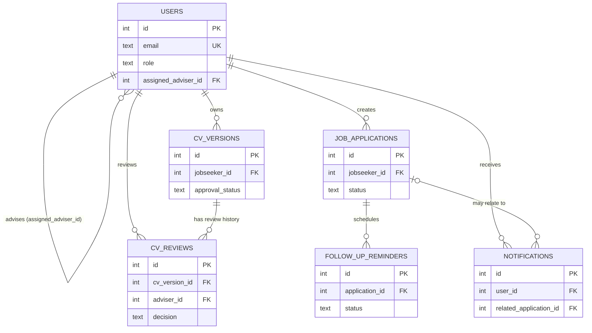
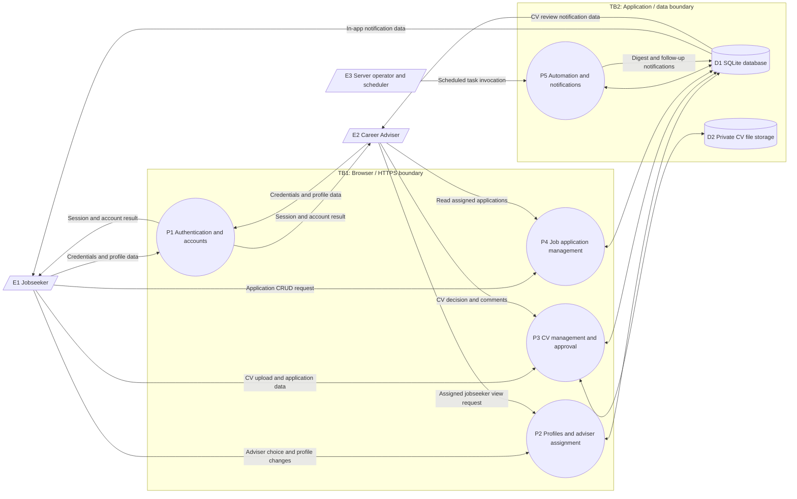

# Job Application Tracker — Product and Technical Specification

**Document type:** Proof-of-concept (PoC) specification  
**Version:** 1.0  
**Date:** 20 November 2026  
**Status:** Requirements baseline, based on stakeholder answers

## 1. Purpose and scope

Build a beginner-friendly web application for a career support organisation. Jobseekers record and manage their job applications, maintain one current CV, and work with a career adviser. Career advisers can view the jobseekers assigned to them, review CVs, and approve or reject them with comments.

The PoC must demonstrate:
- Two self-registering account types: **Jobseeker** and **Career Adviser**.
- Sign-in and log-in using email address and password.
- Jobseekers selecting an adviser from a list of registered advisers. Assignment is immediate and permanent.
- CV upload and adviser approval.
- Job application recording and outcome tracking.
- In-app notifications.
- A weekly jobseeker pipeline digest.
- A follow-up nudge seven days after an application if its status is still `Applied`.
- Database relationships, data-level authorisation, a Level-1 data flow diagram, STRIDE threat analysis, and a short GDPR assessment.

This is a PoC specification, not a claim that the system is already production-ready or legally compliant.

## 2. Users, roles and account lifecycle

### 2.1 Roles

There are exactly two application roles:
1. **Jobseeker**
2. **Career Adviser**

There is no administrator role or administrator console. Both roles can register themselves. A role is selected during registration and cannot be changed through ordinary profile editing.

### 2.2 Adviser selection and assignment

- During onboarding, a jobseeker selects one adviser from a list of registered career advisers.
- Assignment is automatic as soon as the jobseeker confirms the selection.
- The selected adviser immediately becomes responsible for that jobseeker and can view the jobseeker's contact details, CV and applications.
- The initial assignment is permanent. A jobseeker cannot change adviser in the PoC.
- A jobseeker cannot access another jobseeker's records. An adviser can access only records belonging to jobseekers assigned to that adviser.

**PoC edge case:** If no advisers are registered, allow the jobseeker to complete basic registration but mark onboarding as `awaiting_adviser`; do not expose the jobseeker's records to any adviser until an adviser is selected. The UI should explain that adviser selection is required to activate support.

### 2.3 Account fields

For both account types:
- Email address (unique; used to log in)
- Password hash (never store a plain-text password)
- Role
- Account creation timestamp

For jobseekers:
- Full name
- Phone number
- Assigned career adviser

For career advisers:
- Full name

Only collect the contact details explicitly required for the PoC. Do not collect date of birth, home address, demographic information or other unnecessary personal data.

### 2.4 Authentication

- Register and log in with email address and password.
- Store passwords using a recognised password-hashing function such as Werkzeug's `generate_password_hash` and verify with `check_password_hash`.
- Use secure, HTTP-only session cookies; configure `Secure` when deployed over HTTPS.
- Protect state-changing forms against CSRF.
- Log out by clearing the session.
- Do not reveal whether an email address exists in authentication error messages.

Email verification and social sign-in are out of scope for this PoC.

## 3. Functional requirements

### 3.1 Jobseeker profile

A jobseeker can:
- Register and log in.
- Enter and update full name, email address and phone number.
- Select one career adviser from the registered adviser list during onboarding.
- View their assigned adviser's name.
- Close their account and request deletion of their personal data.

A jobseeker cannot change their adviser after the initial assignment in this PoC.

### 3.2 Career adviser workspace

A career adviser can:
- Register and log in.
- View a list of jobseekers assigned to them.
- Open an assigned jobseeker's profile.
- View the jobseeker's full name, email address and phone number.
- View the jobseeker's current CV and its approval status.
- Review all job applications and their outcomes.

Career advisers have read-only access to job application records in the PoC. They cannot create, edit or delete a jobseeker's applications.

### 3.3 CV upload and approval

- Each jobseeker has one current CV.
- Accept PDF and Word documents (`.pdf`, `.doc`, `.docx`).
- Store the uploaded file in a private application-managed directory; store only its metadata and generated storage name in SQLite.
- Do not use the original filename as a filesystem path.
- Enforce a configurable upload size limit (initial PoC default: 5 MB).
- Validate extension and content type; do not trust the browser-provided MIME type alone.
- CV files must never be publicly accessible by guessing a URL. Serve them through an authenticated route that checks the viewer is the owner or the owner's assigned adviser.
- On first upload, approval status is `Pending`.
- The assigned adviser can review the CV and choose:
  - `Approved`, or
  - `Rejected`.
- The adviser must provide comments with the decision. Comments should explain the decision or any changes needed.
- Record who made the decision and when.
- The jobseeker can view the decision and comments.
- When a jobseeker replaces an already-reviewed CV, retain the previous approval as the status of the previously reviewed version while the new version is awaiting review. The current CV should be marked `Pending`; do not imply that the new file has already been approved.

**Interpretation of the selected update rule:** The previous approval remains valid for the old version only. A newly uploaded version must be clearly identified as not yet reviewed. This avoids displaying an old approval as approval of a different document.

### 3.4 Job application tracking

A jobseeker can create, view, edit and delete their own applications.

Required fields:
- Employer/company name
- Job title
- Date applied
- Job advert URL
- Application status

Allowed statuses:
- `Applied`
- `Successful`
- `Unsuccessful`
- `Withdrawn`

Rules:
- Default status for a new application is `Applied`.
- Jobseekers can update the status at any time.
- Validate that the advert URL is a valid HTTP or HTTPS URL.
- Store timestamps for record creation and last update.
- Show applications in a list, with employer, job title, date applied and current status.
- Provide a simple outcome summary grouped by status.
- Career advisers can view all application fields and outcomes for their assigned jobseekers but cannot change them.

### 3.5 In-app notifications

- Notifications are shown in an in-app notification centre.
- No email, SMS or push notifications are required.
- A user can mark their own notifications as read.
- A notification is visible only to its recipient.
- Notifications should link to the relevant application, digest or CV review where appropriate.

## 4. Automations

The PoC must demonstrate at least three distinct automation patterns: scheduled, event-triggered and human approval.

### 4.1 Scheduled automation — weekly pipeline digest

**Recipient:** Jobseekers only.  
**Frequency:** Once per week.  
**Delivery:** In-app notification.  
**Content:** A personal summary of the jobseeker's applications, grouped by `Applied`, `Successful`, `Unsuccessful` and `Withdrawn`, including total applications and a reporting period.

Requirements:
- Run once per week at a documented, configurable time (default: Monday at 09:00, server local time).
- Create one digest notification per active jobseeker for each weekly run.
- Avoid duplicate digests if the task is retried.
- Do not include another jobseeker's information.
- Record the reporting period and generation timestamp.

### 4.2 Event-triggered automation — seven-day follow-up nudge

**Triggering event:** A jobseeker creates a job application with status `Applied`.

**Behaviour:**
1. When the application is created, create a follow-up reminder record due seven calendar days after the date/time of creation.
2. A background worker checks reminders that are due.
3. If the application still exists and its status is still `Applied`, create an in-app follow-up notification for the jobseeker.
4. If the status has changed to `Successful`, `Unsuccessful` or `Withdrawn`, mark the reminder as skipped/cancelled and do not send a nudge.
5. Mark a reminder as processed after handling it so it cannot send duplicate notifications.

The nudge is a reminder to the jobseeker to consider following up with the employer; the system does not contact the employer.

If a jobseeker changes a non-`Applied` application back to `Applied`, create a new seven-day reminder or reset the existing pending reminder. Implement one consistent rule and document it in code; recommended PoC behaviour is to create a new reminder when the status is changed back to `Applied`.

### 4.3 Human approval automation — CV sign-off

**Trigger:** A jobseeker uploads a new CV version.

**Human step:** The assigned career adviser reviews the CV and submits `Approved` or `Rejected`, with comments.

**Result:**
- Save the decision, adviser identity, comments and timestamp.
- Update the CV version's approval state.
- Create an in-app notification for the jobseeker.
- Keep the approval history so the decision can be evidenced.

This is a human-in-the-loop workflow, not an automatic approval.

### 4.4 Simple PoC automation implementation

Keep the implementation understandable to a beginner:
- Put scheduled task logic in a separate Python script, for example `run_automations.py`.
- Use the standard operating-system scheduler (cron on Linux/macOS or Task Scheduler on Windows) to run it. Document the schedule and test command.
- The script should run the weekly digest and process due follow-up reminders.
- The application-creation route performs the event action of inserting a reminder due seven days later.
- The adviser approval form performs the human approval action.

This avoids introducing a task queue or scheduler dependency. Do not rely on a background thread started inside Flask; it can run more than once under multiple web workers or stop when the web process stops.

## 5. Data model

Use SQLite with at least the following related tables. Every table has a primary key; foreign keys link related records. Enable SQLite foreign-key enforcement on every database connection using `PRAGMA foreign_keys = ON`.

### 5.1 `users`

| Column | Type | Rules |
|---|---|---|
| `id` | INTEGER | Primary key |
| `email` | TEXT | Required, unique |
| `password_hash` | TEXT | Required |
| `role` | TEXT | Required; `jobseeker` or `career_adviser` |
| `full_name` | TEXT | Required |
| `phone` | TEXT | Nullable; required for jobseekers |
| `assigned_adviser_id` | INTEGER | Nullable FK to `users.id`; jobseekers only |
| `created_at` | TEXT | Required timestamp |
| `account_status` | TEXT | Required; e.g. `active`, `awaiting_adviser` |

The `assigned_adviser_id` self-reference must point to a user whose role is `career_adviser`. Enforce this in application validation and, where practical, a SQLite trigger.

### 5.2 `cv_versions`

| Column | Type | Rules |
|---|---|---|
| `id` | INTEGER | Primary key |
| `jobseeker_id` | INTEGER | Required FK to `users.id` |
| `stored_filename` | TEXT | Required; generated name, not original path |
| `original_filename` | TEXT | Required; display metadata only |
| `uploaded_at` | TEXT | Required timestamp |
| `approval_status` | TEXT | Required; `pending`, `approved`, `rejected` |
| `reviewed_by` | INTEGER | Nullable FK to `users.id` |
| `reviewed_at` | TEXT | Nullable timestamp |

Keep multiple rows to preserve the CV approval history, but allow only one current CV per jobseeker (for example, with an `is_current` boolean and a partial unique index).

### 5.3 `cv_reviews`

| Column | Type | Rules |
|---|---|---|
| `id` | INTEGER | Primary key |
| `cv_version_id` | INTEGER | Required FK to `cv_versions.id` |
| `adviser_id` | INTEGER | Required FK to `users.id` |
| `decision` | TEXT | Required; `approved` or `rejected` |
| `comments` | TEXT | Required |
| `reviewed_at` | TEXT | Required timestamp |

This table is the immutable review history. Validate that the adviser is the assigned adviser for the CV's jobseeker.

### 5.4 `job_applications`

| Column | Type | Rules |
|---|---|---|
| `id` | INTEGER | Primary key |
| `jobseeker_id` | INTEGER | Required FK to `users.id` |
| `employer_name` | TEXT | Required |
| `job_title` | TEXT | Required |
| `date_applied` | TEXT | Required date |
| `job_url` | TEXT | Required valid HTTP/HTTPS URL |
| `status` | TEXT | Required; one of the four allowed statuses |
| `created_at` | TEXT | Required timestamp |
| `updated_at` | TEXT | Required timestamp |

### 5.5 `follow_up_reminders`

| Column | Type | Rules |
|---|---|---|
| `id` | INTEGER | Primary key |
| `application_id` | INTEGER | Required FK to `job_applications.id` |
| `due_at` | TEXT | Required timestamp |
| `status` | TEXT | Required; `pending`, `sent`, `skipped` |
| `processed_at` | TEXT | Nullable timestamp |
| `created_at` | TEXT | Required timestamp |

### 5.6 `notifications`

| Column | Type | Rules |
|---|---|---|
| `id` | INTEGER | Primary key |
| `user_id` | INTEGER | Required FK to `users.id` |
| `notification_type` | TEXT | Required; e.g. `weekly_digest`, `follow_up`, `cv_review` |
| `title` | TEXT | Required |
| `message` | TEXT | Required |
| `related_application_id` | INTEGER | Nullable FK to `job_applications.id` |
| `created_at` | TEXT | Required timestamp |
| `read_at` | TEXT | Nullable timestamp |
| `deduplication_key` | TEXT | Nullable; unique when present |

### 5.7 Relationships (ERD)



**ERD evidence:** Include this diagram in the submission and, if required, export it as an image from a Mermaid-compatible editor. The six tables above exceed the minimum of three related tables.

## 6. Role-based access control (data-level)

Hiding buttons is not access control. Every route that reads or changes private data must enforce role, ownership and adviser-assignment checks on the server. SQL queries must be scoped to the authenticated user's permitted records.

### 6.1 CRUD permission matrix

Legend: **C** = create, **R** = read, **U** = update, **D** = delete, **—** = no access.

| Data / action | Jobseeker | Career Adviser |
|---|---|---|
| Own basic profile | C/R/U/D (account closure) | C/R/U/D (account closure) |
| Other users' profiles | — | R for assigned jobseekers only; no access to other advisers' users |
| Adviser directory | R | R |
| Adviser assignment | Select once during onboarding; cannot change | R for assigned jobseekers; cannot reassign |
| Own CV upload | C/R/U (new version)/D via account closure | — |
| Assigned jobseeker CV | R | R |
| CV review and decision | R own result | C; R review history; no edit/delete of submitted review |
| Own job applications | C/R/U/D | — |
| Assigned jobseekers' applications | — | R |
| Own notifications | R/U (mark read) | R/U (mark read) |
| Other users' notifications | — | — |

### 6.2 Required server-side enforcement

Examples of safe query patterns:
- Jobseeker application list: `SELECT ... FROM job_applications WHERE jobseeker_id = ?` using the logged-in user's ID.
- Adviser jobseeker list: `SELECT ... FROM users WHERE assigned_adviser_id = ? AND role = 'jobseeker'` using the logged-in adviser's ID.
- Adviser CV access: retrieve the CV only when its owner has `assigned_adviser_id` equal to the logged-in adviser ID.
- Adviser application access: retrieve an application only when its `jobseeker_id` belongs to a jobseeker assigned to the logged-in adviser.
- Notification access: always include `WHERE user_id = ?` for the logged-in user.
- Update/delete routes must include ownership in the SQL predicate, not merely fetch by record ID and trust the URL.

Use parameterised SQL (`?` placeholders) for every query containing user input. Never concatenate user input into SQL.

**SQLite limitation:** SQLite does not provide built-in row-level security policies like PostgreSQL. For this Flask + SQLite PoC, enforce data-level authorisation in server-side route/service functions and ownership-scoped SQL statements, optionally backed by database triggers for critical invariants. Do not describe UI-only hiding as role-based security.

## 7. Level-1 data flow diagram (DFD)

### 7.1 External entities

- **E1 Jobseeker:** registers, signs in, manages profile/CV/applications, receives in-app notifications.
- **E2 Career Adviser:** registers, signs in, views assigned jobseekers and reviews CVs.
- **E3 Organisation's server operator / host environment:** runs the Flask application, stores the SQLite database and private CV files, and runs the scheduled automation command. This is an operational boundary, not an application administrator role.

### 7.2 Processes

- **P1 Authentication and account management:** registration, login, logout and session management.
- **P2 Jobseeker and adviser management:** profile access and permanent adviser assignment.
- **P3 CV management and approval:** secure upload, retrieval, adviser review and decision.
- **P4 Job application management:** create, list, update and delete applications and outcomes.
- **P5 Automation and notification processing:** weekly digest, due follow-up reminders and in-app notification creation.

### 7.3 Data stores

- **D1 SQLite database:** users, adviser assignments, CV metadata and reviews, applications, reminders and notifications.
- **D2 Private CV file storage:** uploaded PDF/Word documents, accessible only through authorised Flask routes.

### 7.4 Trust boundaries and flows

- **TB1 Browser-to-application boundary:** user browser to Flask over HTTPS. Treat all submitted form fields, URLs, cookies and uploaded files as untrusted.
- **TB2 Application-to-data boundary:** Flask process to SQLite and private file storage. Only the application service account should access these stores.
- **TB3 User-role boundary:** jobseeker data must not cross into another jobseeker's view; adviser access is limited to assigned jobseekers. Enforce on every request.
- **TB4 Scheduled-process boundary:** operating-system scheduler invokes the automation script, which reads and writes the same database and creates notifications. Restrict execution and file permissions.

### 7.5 Level-1 DFD diagram



The diagram identifies all external entities, processes, data stores and trust boundaries. In the final evidence pack, ensure the trust-boundary labels remain visible when exporting the diagram.

## 8. STRIDE threat analysis

Apply STRIDE to every flow crossing a trust boundary. The table below identifies representative threats and required mitigations for the PoC.

| Flow / boundary | STRIDE category | Threat | Mitigation |
|---|---|---|---|
| Browser → P1, TB1 | Spoofing | Attacker logs in as another user using stolen or guessed credentials | Password hashing, rate limiting, generic login errors, secure sessions and logout |
| Browser → P1, TB1 | Tampering | User changes submitted role to register as a different role | Validate role server-side; accept only the two allowed roles; never trust hidden form fields |
| Browser → P2, TB1/TB3 | Elevation of privilege | Jobseeker changes adviser ID or accesses another user's profile | Server-side role checks; permanent assignment; ownership-scoped SQL; validate adviser role |
| Browser → P3, TB1 | Tampering | Malicious or oversized file is uploaded as a CV | Allow-list extensions, size limit, content validation, generated filenames, private storage; consider malware scanning before production |
| Browser → P3, TB1/TB3 | Information disclosure | User guesses a CV URL or accesses another jobseeker's CV | No public file URLs; authenticated download route; verify owner or assigned adviser on every download |
| Browser → P3, TB1 | Repudiation | Adviser denies approving or rejecting a CV | Append-only review history with adviser ID, decision, comments and timestamp |
| Browser → P3, TB1 | Denial of service | Repeated large uploads exhaust disk space | Upload size limit, request limits, storage monitoring and controlled error handling |
| Browser → P4, TB1/TB3 | Spoofing | Attacker submits an action using another user's session | Secure cookie settings, HTTPS, CSRF protection and session invalidation on logout |
| Browser → P4, TB1 | Tampering | Malicious input alters SQL or stored application records | Parameterised SQL, server-side validation and allow-listed statuses |
| Browser → P4, TB1/TB3 | Information disclosure | Jobseeker reads or edits another person's application by changing an ID in the URL | Include authenticated owner ID in every read/update/delete query |
| Browser → P4, TB1 | Repudiation | User disputes an application status change | Store created/updated timestamps; for stronger evidence add a status-change history table |
| Browser → P4, TB1 | Denial of service | Excessive requests or invalid URL submissions overload the app | Request-size limits, basic rate limiting at deployment proxy, input validation and error handling |
| P1/P2/P3/P4 → D1, TB2 | Tampering | SQL injection or invalid references corrupt database records | `sqlite3` parameter binding, foreign keys, transactions, constraints and restricted file permissions |
| P1/P2/P3/P4 → D1, TB2 | Information disclosure | Database file or backups are read by an unauthorised local user | Restrict OS file permissions, protect backups, avoid storing unnecessary data, encrypt storage at host level where appropriate |
| P3 → D2, TB2 | Tampering | Stored file is overwritten or path traversal accesses unrelated files | Generate random storage names, normalise and validate uploads, never build paths from user input |
| P3 → D2, TB2 | Information disclosure | Private CV files are exposed by web-server static-file configuration | Keep CV directory outside public static directory; stream files only after authorisation |
| P5 → D1, TB4 | Spoofing | Unauthorised user invokes or alters scheduled automation | Run the script only under the application OS account; do not expose an unauthenticated web endpoint for it |
| P5 → D1, TB4 | Tampering | Reminder or digest records are changed to send false or duplicate messages | Parameterised SQL, transactions, unique deduplication keys and processed-state checks |
| P5 → D1, TB4 | Repudiation | It is unclear whether an automation ran or sent a digest | Record run time and outcome in a small automation-run log; log errors without sensitive CV content |
| P5 → D1, TB4 | Denial of service | Automation repeatedly processes the same due records | Process records in bounded batches, mark each processed transactionally, and make jobs idempotent |

**Additional security baseline:** use HTTPS in deployment, CSRF protection, output escaping in templates, secure headers, dependency updates, backups with restricted access, and no sensitive data in application logs. A PoC should not be exposed publicly with Flask debug mode enabled.

## 9. GDPR and data protection write-up

This section is a proposed design baseline. The organisation must confirm its lawful basis, retention obligations and privacy notices with its data protection lead before real personal data is processed.

### 9.1 Personal data processed

- Account email address and password hash.
- Jobseeker full name and phone number.
- Adviser assignment.
- CV documents, which may contain substantially more personal information than the application needs.
- Job application employer, job title, application date, advert URL and outcome.
- CV review decision and comments.
- In-app notifications and timestamps.

Do not collect additional personal data unless a defined service need is established.

### 9.2 Lawful basis

A likely basis for the core career-support service is **performance of a contract** (GDPR Article 6(1)(b)) where processing is objectively necessary to provide the service the jobseeker requested and the organisation is party to that service arrangement.

If the organisation is providing a publicly funded or statutory service, it should assess whether **public task** (Article 6(1)(e)) is the correct basis instead. Do not assume consent is the default lawful basis for all core processing. Document the chosen basis and purpose for each processing activity.

### 9.3 Data minimisation

- Collect only full name, email and phone number for jobseeker contact details.
- Collect only the specified job application fields.
- Store one current CV for the active workflow, while retaining previous versions only as long as needed for review history.
- Do not collect date of birth, home address, protected-characteristic data or unrelated employment information in the PoC.
- Avoid placing CV content or unnecessary personal details in automation logs or notification previews.

### 9.4 Retention and deletion

The selected requirement is to delete personal data when an account is closed.

Implementation requirements:
- Provide an account-closure process.
- On closure, delete or irreversibly anonymise the user's profile, CV files and metadata, applications, reminders, notifications and review records where they contain or identify that user.
- Handle linked adviser/jobseeker records consistently. For example, if an adviser closes their account, the organisation must decide how to handle jobseekers assigned to that adviser; because there is no administrator role and assignments are permanent, this is an operational exception that must be resolved before production.
- Do not retain data indefinitely in backups. Define backup expiry and ensure deleted data ages out within a documented period.
- A narrow legal retention exception may apply where required by law or necessary for legal claims. Document it, restrict access, and delete when the exception ends.

Immediate deletion from every backup may not be technically practical. The production policy should state the backup deletion cycle clearly; the PoC should delete active records and files and document the backup limitation.

### 9.5 Who can see personal data

| Data | Jobseeker | Assigned career adviser | Other jobseekers / other advisers |
|---|---|---|---|
| Jobseeker name, email, phone | Own | Read | No access |
| Jobseeker CV | Own | Read and review | No access |
| CV approval comments | Own | Create and read review history | No access |
| Job applications and outcomes | Own; create/edit/delete | Read | No access |
| Notifications | Own | Own notifications only | No access |
| Adviser name and account identity | Read selected adviser's basic name | Own profile | No access to private profile data |

The organisation's authorised technical operators may require limited infrastructure access to maintain the service. This is not an application administrator role; such access must be restricted, justified and logged.

### 9.6 Data subject rights and transparency

Provide a clear privacy notice explaining purposes, lawful basis, recipients, retention, rights and contact details for the organisation. Establish a process for access, rectification, erasure, restriction, objection (where applicable) and data portability requests. The PoC account-closure function is not a substitute for a complete data subject rights process.

## 10. Suggested application structure and technology

### 10.1 Required technology

- **Language:** Python
- **Web framework:** Flask
- **Database:** SQLite
- **Database access:** Python's built-in `sqlite3` module only
- **Templates:** Flask/Jinja templates
- **Frontend:** HTML and CSS with minimal JavaScript where needed

Do not add an ORM such as SQLAlchemy. Keep SQL visible and readable so a beginner can follow it.

Use Flask and Werkzeug functionality for sessions and password hashing. Any additional dependency must be justified and kept to a minimum. The operating-system scheduler is preferred over adding a task scheduler package.

### 10.2 Suggested project layout

```text
job_tracker/
├── app.py
├── db.py
├── auth.py
├── jobseekers.py
├── advisers.py
├── applications.py
├── cv_management.py
├── notifications.py
├── automation_tasks.py
├── run_automations.py
├── schema.sql
├── requirements.txt
├── instance/
│   └── job_tracker.sqlite
├── private_uploads/
│   └── cv/
├── templates/
│   ├── base.html
│   ├── login.html
│   ├── register.html
│   ├── jobseeker_dashboard.html
│   ├── adviser_dashboard.html
│   ├── applications.html
│   ├── cv.html
│   └── notifications.html
└── static/
    └── style.css
```

This is a suggested structure; a smaller initial implementation may combine route modules, provided responsibilities remain clear.

### 10.3 SQLite implementation rules

- Use `sqlite3.connect()` and a small helper to create connections.
- Set `row_factory = sqlite3.Row`.
- Execute `PRAGMA foreign_keys = ON` on every connection.
- Use `?` placeholders for values.
- Use transactions and commit/rollback appropriately.
- Keep schema creation in `schema.sql`.
- Add indexes for common lookups such as `job_applications.jobseeker_id`, `users.assigned_adviser_id`, `notifications.user_id` and due reminder status/date.
- Store timestamps consistently in UTC ISO-8601 format; display them in the user's configured/local timezone if added later.

### 10.4 Configuration and deployment

- Keep the Flask secret key outside source control, using an environment variable.
- Keep the SQLite database and CV directory outside the public static directory.
- Use a production WSGI server and HTTPS for deployment; do not use Flask's development server in production.
- Disable debug mode in any shared or deployed environment.
- Back up the database and private files securely.

## 11. Main user journeys

### 11.1 Jobseeker onboarding

1. User opens registration.
2. Selects `Jobseeker`.
3. Enters full name, email, phone and password.
4. Chooses a career adviser from registered advisers.
5. System validates the selected account is a career adviser.
6. System saves the permanent adviser assignment.
7. Jobseeker is taken to their dashboard.

### 11.2 Adviser onboarding

1. User opens registration.
2. Selects `Career Adviser`.
3. Enters full name, email and password.
4. System creates the adviser account.
5. Adviser is taken to a dashboard listing assigned jobseekers (initially possibly empty).

### 11.3 CV review

1. Jobseeker uploads a PDF or Word CV.
2. System stores the file privately and creates a `Pending` CV version.
3. Assigned adviser opens the jobseeker record and views the CV.
4. Adviser enters comments and selects `Approved` or `Rejected`.
5. System saves the review history and updates the CV version.
6. System creates an in-app notification for the jobseeker.
7. Jobseeker sees the decision and comments.

### 11.4 Job application and follow-up

1. Jobseeker creates an application with the five required fields.
2. System saves it with status `Applied` unless another permitted status is selected.
3. System creates a reminder due seven days later.
4. Automation worker checks the reminder when due.
5. If still `Applied`, it creates a follow-up notification.
6. If the application has another status, the reminder is skipped.

### 11.5 Weekly digest

1. Operating-system scheduler runs `run_automations.py` once a week.
2. Script finds active jobseekers.
3. For each jobseeker, it calculates counts for the reporting period or current pipeline (define the selected reporting window consistently).
4. Script creates one in-app digest notification per jobseeker.
5. A deduplication key prevents a second digest for the same user and week.
6. Jobseeker reads the digest in the notification centre.

## 12. Acceptance criteria and PoC tests

### 12.1 Authentication and roles

- [ ] A user can register as a jobseeker.
- [ ] A user can register as a career adviser.
- [ ] Duplicate email registration is rejected.
- [ ] Passwords are stored as hashes, not plain text.
- [ ] A jobseeker cannot access adviser-only CV review actions.
- [ ] An adviser cannot access another adviser's jobseekers.
- [ ] Changing an ID in a URL does not reveal another user's records.
- [ ] SQL injection-style input is treated as data, not executable SQL.

### 12.2 Adviser assignment

- [ ] Jobseeker can select an adviser from registered advisers.
- [ ] Assignment takes effect immediately.
- [ ] A jobseeker cannot change the assigned adviser after onboarding.
- [ ] A selected account must have the career adviser role.
- [ ] An adviser can see only jobseekers assigned to them.

### 12.3 CV

- [ ] Jobseeker can upload one current PDF or Word CV.
- [ ] Unsupported file types and files above the size limit are rejected.
- [ ] CV is not publicly accessible.
- [ ] Assigned adviser can view the CV.
- [ ] Unassigned adviser cannot view it.
- [ ] Adviser can approve or reject with comments.
- [ ] Decision, reviewer and timestamp are saved.
- [ ] Jobseeker receives an in-app notification.
- [ ] Replacing a CV creates a new pending version and preserves prior review history.

### 12.4 Applications

- [ ] Jobseeker can create, read, update and delete their own applications.
- [ ] Required fields are validated.
- [ ] Only the four specified statuses are accepted.
- [ ] Adviser can read assigned jobseekers' applications and outcomes.
- [ ] Adviser cannot change or delete job applications.
- [ ] Other jobseekers cannot access the records.

### 12.5 Automations

- [ ] Weekly digest task creates a digest notification for each active jobseeker.
- [ ] Digest is not sent twice for the same user and week.
- [ ] Creating an `Applied` application creates a reminder due seven days later.
- [ ] A due reminder for an application still `Applied` creates one follow-up notification.
- [ ] A reminder is skipped if the application is no longer `Applied`.
- [ ] Re-running the automation script does not create duplicate notifications.
- [ ] CV approval/rejection is performed by an adviser and creates a notification for the jobseeker.

### 12.6 Data protection and deletion

- [ ] Account closure removes the user's active personal records and private CV files, subject to documented linked-record handling.
- [ ] No unnecessary profile fields are collected.
- [ ] Private data is not written to routine logs.
- [ ] Database and upload directories have restricted filesystem permissions.

## 13. Required evidence submission

Prepare the following evidence for the project submission:

| Requirement | Evidence to submit | What the evidence must show |
|---|---|---|
| Data model | ERD | All tables, primary keys, foreign keys and relationships |
| Automations | Screenshot of each flow and successful test run | Weekly scheduled digest, seven-day event-triggered reminder, CV human approval |
| Role-based access | CRUD permission matrix and test evidence | Two roles and server-side restrictions on actual records |
| Data flow | Level-1 DFD | Every external entity, process, data store, flow and trust boundary |
| Threat analysis | STRIDE threat table | STRIDE applied to each trust-boundary flow, with mitigation |
| Data protection | Short GDPR write-up | Lawful basis, minimisation, retention, access and deletion approach |

### Suggested successful automation test evidence

1. **Weekly digest:** run the automation script manually in test mode; show a digest notification in a test jobseeker's notification centre and the corresponding database row.
2. **Follow-up nudge:** create an application, adjust its test reminder due time to the past (do not wait seven days), run the automation script, and show the notification and reminder status. Also test that a non-`Applied` application is skipped.
3. **CV approval:** upload a test CV as a jobseeker, sign in as the assigned adviser, approve or reject with comments, and show the saved review and jobseeker notification.

Use test accounts and synthetic CV/application data for screenshots. Redact real personal information.

## 14. Assumptions and decisions to confirm before production

The following points are deliberately made explicit because they were not fully specified in the initial requirements:

1. **Adviser account closure:** With no administrator and permanent adviser assignment, the system needs a defined process if an adviser closes their account. The PoC should prevent adviser account closure while jobseekers remain assigned, or clearly mark the affected accounts for manual organisational resolution outside the app.
2. **Jobseeker account closure:** Deleting a jobseeker also affects linked CV reviews, applications, reminders and notifications. Use a database transaction and delete private files safely.
3. **CV replacement:** A new upload is pending review; an old approval applies only to the old version.
4. **Digest period:** Default to a weekly digest of the jobseeker's current pipeline, grouped by status, with a clearly displayed reporting week. If only changes during the previous week are wanted, implement that as a separate requirement.
5. **Reminder timing:** Seven calendar days after application creation. Store UTC timestamps and compare consistently.
6. **Application status history:** The minimum schema stores the current status and update timestamp. A separate status-history table is recommended if the project needs an auditable record of every status change.
7. **No employer contact:** Follow-up nudges are in-app reminders to jobseekers; the system does not email or message employers.
8. **No email verification or password reset:** These are outside the selected PoC authentication scope, but should be considered before production.
9. **No real production data until safeguards are reviewed:** The organisation must validate its GDPR lawful basis, privacy notice, retention and security controls before launch.

---

**End of specification.**
