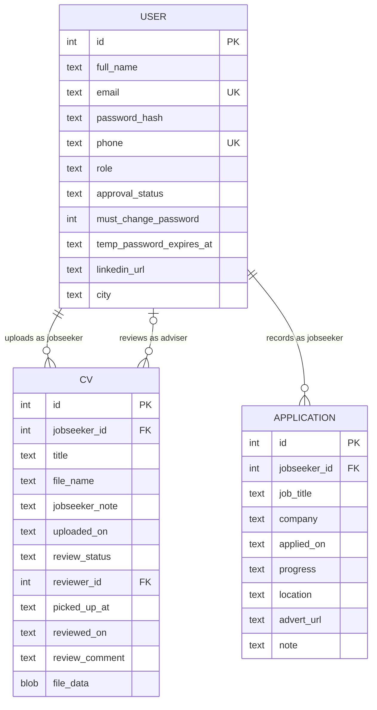

# Data model: Job Application Tracker

> Draft written from the interview (Prompt 01), BEFORE any schema is generated.
> Read it, correct it, and delete every "(GUESS: please check)" by fixing it or confirming it.
> **The delete rule is your decision.** Everything in the delete section is what you told me, in your words.
> Then commit it first:
> `git add docs/data-model.md` and `git commit -m "Add data model (written before generating the schema)"`

Table, column, status and role names below are my wording (GUESS: please check). Dates are stored as TEXT in the form `YYYY-MM-DD`. The two date-and-times (the moment an adviser picks up a CV, `picked_up_at`, and the moment a temporary password stops working, `temp_password_expires_at`) are TEXT in the form `YYYY-MM-DD HH:MM:SS`, in UTC, and the app shows them in Irish time (GUESS: please check).

## The app in one sentence

Jobseekers use it to upload their CVs and record the jobs they apply for; approved career advisers review the CVs; one administrator approves advisers and removes profiles or applications that break the rules.

## Entities (the things the app stores)

| Entity | One row means... |
|---|---|
| user | one person with an account: a jobseeker, a career adviser, or the one admin |
| cv | one CV file uploaded by one jobseeker, with its review record |
| application | one job application recorded by one jobseeker |

## Fields

In every "not blank" rule below, spaces, tabs and new lines all count as blank, so a value made only of them is refused.

### user

| Field | Type | Required? | Rules (constraints) | Example |
|---|---|---|---|---|
| id | INTEGER | yes | PRIMARY KEY AUTOINCREMENT | 1 |
| full_name | TEXT | yes | NOT NULL; CHECK not blank and at most 30 characters; plain text | Aoife Murphy |
| email | TEXT | yes | NOT NULL, UNIQUE; saved in lower case; CHECK basic shape (one "@", something before it, no spaces, and a dot after the "@" that is not right after it and not the last character); no length limit. The stricter check is in Python (GUESS: please check) | aoife@example.ie |
| password_hash | TEXT | yes | NOT NULL; only the protected (scrambled) form is stored, never the password. When a person chooses a password: 8 to 128 characters with at least one letter, one number and one special character (GUESS: please check the 128 cap and what "special character" means). Checked in Python | (protected form) |
| phone | TEXT | yes | NOT NULL, UNIQUE; Irish numbers only. The person may type at most 20 characters ("087 123 4567", "+353 87 123 4567" and "00353 87 123 4567" are the same number). Python cleans it, and the stored form is `+353` followed by 8 to 10 digits, checked by CHECK | +353871234567 |
| role | TEXT | yes | NOT NULL; CHECK one of `jobseeker`, `career_adviser`, `admin`; at most one row may have `admin` (a unique index on role where role = 'admin'). A user's role can never be changed after the account is made (a trigger) | jobseeker |
| approval_status | TEXT | advisers only | CHECK: a `career_adviser` has `waiting` or `approved`; a jobseeker and the admin have NULL. Advisers start as `waiting`. It can only move from `waiting` to `approved` and never back (a trigger refuses any other change) | NULL |
| must_change_password | INTEGER | yes | NOT NULL DEFAULT 0, CHECK 0 or 1. It is 1 only after a temporary password was set, and 0 once the user chooses their own | 0 |
| temp_password_expires_at | TEXT | only when must_change_password = 1 | `YYYY-MM-DD HH:MM:SS`, UTC, exactly 24 hours after the temporary password was made. CHECK: filled exactly when must_change_password = 1 | NULL |
| linkedin_url | TEXT | no | Must start with `http://` or `https://`, no spaces, and the host must be `linkedin.com` or a subdomain such as `www.linkedin.com`. The database checks the rough pattern, Python checks the exact host. No length limit | https://www.linkedin.com/in/aoife-murphy |
| city | TEXT | no | Plain text, at most 20 characters; if given, not blank (GUESS: please check) | Dublin |

The same rules apply to every role, the admin included.

### cv

| Field | Type | Required? | Rules (constraints) | Example |
|---|---|---|---|---|
| id | INTEGER | yes | PRIMARY KEY AUTOINCREMENT | 1 |
| jobseeker_id | INTEGER | yes | NOT NULL, FOREIGN KEY to user(id), ON DELETE CASCADE. The owner must have the role `jobseeker` (a trigger) | 1 |
| title | TEXT | yes | NOT NULL; CHECK not blank and at most 30 characters | CV for IT jobs |
| file_name | TEXT | yes | NOT NULL; CHECK ends in `.pdf`, `.doc` or `.docx` (any letter case), with at least one character before the dot, and at most 255 characters (GUESS: please check the 255) | aoife_cv.pdf |
| jobseeker_note | TEXT | no | Plain text, at most 200 characters. A note for the adviser | Applying for junior roles |
| uploaded_on | TEXT | no | `YYYY-MM-DD` | 2026-11-17 |
| review_status | TEXT | yes | NOT NULL DEFAULT `waiting_for_review`; CHECK one of `waiting_for_review`, `in_review`, `approved`, `rejected`, `needs_changes` | waiting_for_review |
| reviewer_id | INTEGER | every status except waiting | FOREIGN KEY to user(id), ON DELETE SET NULL (but a trigger resets the CV first, see the delete rule). The reviewer must be an approved adviser (a trigger) | 7 |
| picked_up_at | TEXT | only while `in_review` | `YYYY-MM-DD HH:MM:SS`, UTC. The moment the adviser picked the CV up | NULL |
| reviewed_on | TEXT | only after a decision | `YYYY-MM-DD` | NULL |
| review_comment | TEXT | see the rule below | Plain text, at most 200 characters | Please add your dates of employment. |
| file_data | BLOB | yes | NOT NULL; the file itself, stored inside the database as a real BLOB (never as text, so Python must pass bytes). CHECK not empty and at most 5,242,880 bytes (GUESS: please check: 5 MB read as 5,242,880). PDF or Word only; the real file type is checked in Python. It is the last column on purpose: SQLite stores a big file in extra pages, so reading any column that comes after it is much slower | (the file) |

**The matching rule for reviews (the database enforces it with CHECK):**

| review_status | reviewer_id | picked_up_at | reviewed_on | review_comment |
|---|---|---|---|---|
| waiting_for_review | empty | empty | empty | empty |
| in_review | required | required | empty | empty |
| approved | required | empty | required | optional |
| rejected | required | empty | required | required (not blank) |
| needs_changes | required | empty | required | required (not blank) |

A new CV always starts as `waiting_for_review`. A decision (approved, rejected, needs changes) is final. A CV cannot be edited after upload: to change anything, the jobseeker deletes it and uploads a new one. A trigger enforces this: it refuses any change to the owner, title, file name, file, note or upload date (only the review columns can change). Nothing links one CV to another.

### application

| Field | Type | Required? | Rules (constraints) | Example |
|---|---|---|---|---|
| id | INTEGER | yes | PRIMARY KEY AUTOINCREMENT | 1 |
| jobseeker_id | INTEGER | yes | NOT NULL, FOREIGN KEY to user(id), ON DELETE CASCADE. The owner must have the role `jobseeker` (a trigger) | 1 |
| job_title | TEXT | yes | NOT NULL; CHECK not blank and at most 40 characters | Junior Developer |
| company | TEXT | yes | NOT NULL; CHECK not blank and at most 30 characters | Acme Ltd |
| applied_on | TEXT | yes | NOT NULL; `YYYY-MM-DD` | 2026-11-10 |
| progress | TEXT | yes | NOT NULL DEFAULT `applied`; CHECK one of `applied`, `interview`, `accepted`, `rejected`, `withdrawn`. "Rejected" means the employer said no; "withdrawn" means the jobseeker pulled out | applied |
| location | TEXT | no | Plain text, at most 20 characters. City or "remote" | Dublin |
| advert_url | TEXT | no | Must start with `http://` or `https://` and contain no spaces. No length limit and not tied to any one website | https://example.com/jobs/123 |
| note | TEXT | no | Plain text, at most 200 characters | Phone interview on Friday |

An application is not linked to a CV.

Tip: SQLite has no date type. Store dates as TEXT in the form `YYYY-MM-DD` so they sort and compare correctly. SQLite's own `date()` function can check that a date is real (for example, no 31 February), so the database does this with CHECK. Careful at the schema stage: for an impossible date such as month 13, `date()` returns NULL, and a CHECK lets NULL through, so the rule must refuse that case explicitly. The same applies to the two date-times (`picked_up_at` and `temp_password_expires_at`) and `datetime()`.

## Relationships

- One jobseeker has many CVs. Each CV belongs to exactly one jobseeker.
- One jobseeker has many applications. Each application belongs to exactly one jobseeker.
- One adviser reviews many CVs. Each CV has at most one reviewer, and none while it is waiting for review.
- Applications and CVs are not linked to each other.
- Nothing refers to the admin.

## Indexes (for speed only)

SQLite does not index a foreign key by itself. Without an index, every "show my CVs" page and every `ON DELETE CASCADE` has to read the whole table, and the `cv` table holds whole files. These indexes change no rule, they only make lookups faster.

| Index | On | Used for |
|---|---|---|
| user_one_admin | user (role), only where role = 'admin' | the "at most one admin" rule (unique) |
| cv_jobseeker_id_idx | cv (jobseeker_id) | a jobseeker's CV list, and the cascade when an account is deleted |
| cv_reviewer_id_idx | cv (reviewer_id) | an adviser's CVs, and the reset when an adviser is deleted |
| cv_review_status_idx | cv (review_status) | the "waiting for review" list and the 7-day check |
| application_jobseeker_id_idx | application (jobseeker_id) | a jobseeker's application list, and the cascade when an account is deleted |

## The delete rule (my decision, with my reason)

### A jobseeker who still has CVs and applications

If someone deletes a jobseeker (the admin deletes the profile, or the jobseeker cancels the account) that still has CVs and applications:

- [ ] **RESTRICT**: block the delete.
- [x] **CASCADE**: delete the CVs and applications too, silently.
- [ ] **SET NULL**: keep the children but empty their link.

**I chose:** CASCADE

**Because:** The reason for CASCADE way of deleting is protecting data privacy. With CASCADE mode no data remains stored in the web app. It represents the safest option for users.

The app asks "are you sure?" first. Deleting a jobseeker also deletes any CV that is "in review".

### An adviser who has reviewed CVs

If someone deletes an adviser (the admin deletes the profile, or the adviser cancels the account):

- [ ] **RESTRICT**: block the delete.
- [ ] **CASCADE**: delete the CVs too.
- [x] **SET NULL**: keep the CVs but empty the link, plus reset the review.

**I chose:** SET NULL, plus a reset. The CV stays and goes back to `waiting_for_review`. The reviewer, picked-up time, review date and comment are wiped. The title, file, jobseeker's note and owner are untouched. This applies to CVs in every status, an approved CV included.

**Because:** CVs belong to the jobseeker, that's why they are not deleted. All the other actions (pick-up time, review and comments) are related to the adviser's work, so they have to be cancelled together with the adviser's profile.

Emptying the reviewer alone would break the matching rule for reviews, so a trigger on the `user` table resets each of the adviser's CVs first, and then the delete goes through, all in one statement. The code just deletes the adviser. The matching rule stays as the safety net: if the reset ever failed, the delete would be refused instead of leaving a broken CV.

### The other cases

| Someone deletes... | What happens | Reason |
|---|---|---|
| A waiting adviser the admin rejects | The profile is deleted at once, with "are you sure?". The adviser is not told. They can register again | Rejected advisers don't have to be stored, so no data remains |
| One CV (the jobseeker only) | The CV and its review record are deleted, in any status except `in_review` | Privacy: a jobseeker may delete even an approved CV. An "in review" CV is deleted only when the whole account is deleted |
| One application (the jobseeker, or the admin) | It is deleted alone, with "are you sure?". An admin's deletion leaves no record and the jobseeker is not told | The admin must be able to act on misbehaviour |
| The admin | Refused. No delete or cancel button exists and the database refuses it | My rule |

### How the database is opened

Every connection is opened by `get_connection()` in `db.py`, which runs `PRAGMA foreign_keys = ON` and also `PRAGMA secure_delete = ON`. With `secure_delete`, deleted data is overwritten with zeros in the database file, so a deleted CV or account leaves no readable trace there. It does not cover backup copies or traces elsewhere on the computer's disk.

## Diagram

GitHub draws this as a picture when you view the file.

## Who can see and do what

The database does not know who is logged in, so the Python code enforces all of this.

**Jobseeker**
- Registers freely, with no approval.
- Sees only their own CVs and applications. Sees the reviewer's name and comment on a reviewed CV.
- Uploads CVs. Cannot edit a CV afterwards. Deletes any own CV except one that is `in_review`.
- Records, edits and deletes their own applications at any time.
- Changes their own password by typing the old one first (GUESS: please check: I assumed this page exists).
- Cancels their own account, with "are you sure?".

**Approved career adviser**
- Registers as `waiting` and cannot log in until the admin approves them.
- Sees all CVs, including the files, and the jobseeker's name next to each (not the email or phone) (GUESS: please check).
- Sees a jobseeker's applications only while they are the reviewer of one of that jobseeker's CVs. Access starts when they pick the CV up, and ends if the CV goes back to waiting or is deleted.
- Picks up a `waiting_for_review` CV, which becomes `in_review`. Only that adviser can finish the review, with approved, rejected or needs changes. They cannot hand a CV back.
- A CV left `in_review` for 7 days (exactly 7 days from the picked-up time) returns to `waiting_for_review` and its reviewer is emptied.
- Is read-only for everything else.
- Cancels their own account, with "are you sure?".

**The admin**
- There is exactly one admin, created by the setup command.
- Approves a waiting adviser (waiting to approved), or rejects one, which deletes the profile. An approved adviser cannot be changed back.
- Deletes jobseeker and adviser profiles, and single applications. Cannot delete a single CV. Cannot edit anything.
- Reads applications, the jobseeker's notes, the advisers' review comments, and each CV's title, status and reviewer, together with the owner's name, email and phone (GUESS: please check). Cannot open CV files and does not see their file names.
- Sees a list of users: name, email, phone, role and approval status.
- Sets a temporary password for a jobseeker or adviser who forgot theirs.
- Cannot be deleted and cannot cancel their own account.

## Setup, passwords and logins

- Until the admin exists, the app shows only a "setup not finished" page and registration is closed. Nobody can register as admin. The registration form offers only "jobseeker" and "career adviser".
- **Three small programs in the `tools` folder** (the names are my wording) (GUESS: please check). Only a person at the computer where the app runs can start them. No page or button in the app can. Each takes the database file as an argument and uses `get_connection()`:
  - `tools/create_admin.py` creates the one admin. It asks for name, email, phone and password (typed twice, not shown). It refuses to run if an admin already exists.
  - `tools/reset_admin_password.py` sets a new admin password (typed twice, not shown). It does not force a change and refuses to run if no admin exists.
  - `tools/set_temporary_password.py` sets a temporary password for a jobseeker or adviser, found by email.
- **Temporary passwords.** The admin (inside the app) or the tool above asks the app to make a random 12-character password without look-alike characters such as O and 0 (GUESS: please check). It is shown once and stored only in protected form. It lasts 24 hours. `must_change_password` becomes 1, and until the user chooses their own password they can reach only the "choose a new password" page and "log out". The new password cannot be the same as the temporary one. An expired temporary password stops working, nothing is deleted, and the user sees a friendly "ask the administrator for a new one" message. Setting another temporary password restarts the 24 hours. Nobody can set one for the admin.
- **Logins.** A waiting adviser, a missing account and a wrong password all give the same friendly message. A missing page returns 404, and a rejected database write shows a friendly message on the form, never a Python error page.
- No password, secret key or setup code is written in a `.py` file. Secrets come from environment variables.

## Registration notice

Shown as plain text on the registration page (GUESS: please check the wording):

> Approved career advisers can see all uploaded CVs. An adviser who picks up or reviews one of your CVs can also see your job applications. The administrator can see your name, email address and phone number, your applications, your notes and advisers' comments on your CVs, and can delete an application or an account that breaks the rules. The administrator cannot open your CV files. You can cancel your account at any time, and everything you stored is then erased.

## Rules the database enforces on its own

These are the CHECK, UNIQUE, foreign-key and trigger rules inside `schema/001_initial.sql`.

- Foreign keys on every relationship, and `PRAGMA foreign_keys = ON` and `secure_delete = ON` on every connection.
- NOT NULL on every required field. UNIQUE on email and phone.
- Allowed lists: role, approval status, review status, progress, and yes/no on must_change_password.
- At most one admin, and the admin cannot be deleted (a trigger).
- A user's role never changes (a trigger). An adviser's approval status only moves from `waiting` to `approved` (a trigger).
- The approval status matches the role.
- The matching rule for reviews (reviewer, picked-up time, review date, comment).
- The must_change_password and temporary-expiry match.
- A CV and an application belong to a jobseeker, and a CV's reviewer is an approved adviser (triggers).
- Deleting an adviser first resets all of their CVs to `waiting_for_review` (a trigger).
- A CV cannot be edited after upload: only the review columns can change (a trigger).
- Length limits on every text field that has one (email, LinkedIn link, advert link and password hash have none), the CV file size and that the file is a real, non-empty BLOB, and the CV file name ending and length, and the stored phone form.
- The email is saved in lower case, the rough patterns for email, LinkedIn link and advert link, and real dates and date-times (no 31 February, no month 13).
- Indexes on the foreign-key columns, for speed (see "Indexes").

## Rules the database cannot enforce alone (the Python code checks these)

1. Only the adviser who picked up a CV can finish its review, and a decision (approved, rejected, needs changes) is final. The one exception is the reset when its adviser is deleted. (The database already makes sure a reviewer is an approved adviser.)
2. A jobseeker cannot delete a CV that is `in_review`, but deleting the whole account removes it. The database cannot tell these two apart, so this is a Python check.
3. The 7-day return to `waiting_for_review`, and writing the picked-up time in UTC. SQLite has no timer, so the check runs when someone opens a page that shows CVs. If nobody opens the app, an overdue CV stays `in_review` until someone does.
4. Rejecting a waiting adviser deletes the profile. No delete or cancel button exists for the admin (the database trigger is the safety net).
5. The forced password change, the 24-hour expiry check at login, and who may set a temporary password (only the admin in the app, or the command-line tool, and only for jobseekers and advisers). The password generator follows the password rule.
6. The password rule, and that a new password differs from the temporary one.
7. Phone number cleaning, email lowercasing, the exact LinkedIn host check and the real file-type check.
8. Who sees what, as in the section above, including that the admin sees no CV files or file names, and that the admin deletes applications but never CVs.
9. "Are you sure?" before deleting or cancelling an account, rejecting an adviser, and deleting an application as the admin.

## Known limits

1. **A temporary password is seen by a person.** The app makes it random and shows it once, and it expires after 24 hours. The admin or the person at the computer still sees it and passes it on. OWASP advises against handing passwords over like this. The protections are the random password, the 24-hour expiry, the forced change at the next login, and the habit of phoning the user's registered number before setting one.
2. **CV files are stored unencrypted** in the one database file. This is my choice and I accept it. The protection is outside the app: keep `app.db` out of Git, use disk encryption on the computer, and be careful with backups.
3. **Inactive accounts are never deleted automatically.** A jobseeker or adviser who goes quiet keeps their account until they cancel it or the admin deletes it.
4. **There is no limit on wrong logins.** Anyone can keep guessing a password.
5. **`secure_delete` covers only the database file.** Backup copies and traces on the computer's disk can still hold old data.
6. **An adviser's access to a jobseeker's applications starts when they pick up a CV,** and lasts as long as that CV exists with that adviser as its reviewer.
7. **A rejected adviser is not remembered.** They can register again, and they are not told they were rejected.

## What I changed after testing

Fill this in as you go. It is great material for the "design decisions" section of your CA2 write-up.

| Date | What I changed | Why (what testing showed me) |
|---|---|---|
| 2026-11-19 | Fixed the date-time sentence at the top: there are two date-times, `picked_up_at` and `temp_password_expires_at`, not one | Comparing this document with the SQL showed that the SQL header ("two date-times") was right and this document was wrong |
| 2026-11-19 | Added triggers: an adviser's CVs are reset when the adviser is deleted; a CV or application must belong to a jobseeker; a reviewer must be an approved adviser | Testing showed the database refused to delete any adviser who had reviewed a CV, and accepted a CV owned by an adviser, or reviewed by a jobseeker or a waiting adviser |
| 2026-11-19 | Added triggers: a role never changes; approval only moves from waiting to approved; a CV cannot be edited after upload | Testing showed the admin could be turned into a jobseeker (and then deleted), an approved adviser could go back to waiting, and an approved CV's title and file could be changed |
| 2026-11-19 | Added four indexes on the foreign-key and status columns | SQLite does not index foreign keys, so CV lists and account deletes would have to read whole tables |
| 2026-11-19 | Moved `file_data` to the last column of `cv` (SQL, field table and diagram) | In a test with 200 files of 1 MB, listing CVs by status took 38.8 ms with the file first and 0.3 ms with it last |
| 2026-11-19 | Tightened CHECKs: email shape; "not blank" now also refuses tabs and new lines; the CV file must be a real, non-empty BLOB; the file name needs a name before the extension and at most 255 characters | Testing showed `@x.ie`, `a b@x.ie`, `a@.`, a name made only of a new line, an empty file, a file called `.pdf` and a file stored as text were all accepted |
