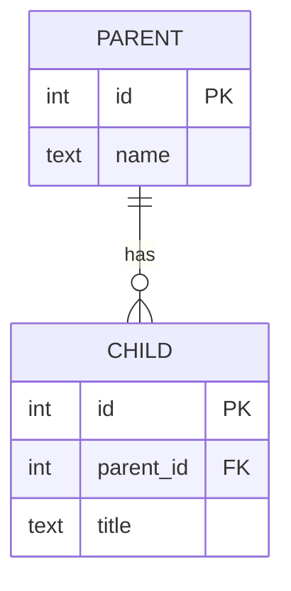

# Data model: [YOUR APP NAME]

> Write this BEFORE you ask an AI to generate a schema, and commit it first.
> Prompt 01 (`prompts/01-interview-me.md`) helps you draft it. You then correct it.
> Everything in [SQUARE BRACKETS] is for you to replace.

## The app in one sentence

[WHO uses it, to do WHAT. For example: "Club committee members use it to see who has borrowed which piece of equipment."]

## Entities (the things the app stores)

| Entity | One row means... |
|---|---|
| [entity_1] | [one ...] |
| [entity_2] | [one ...] |
| [entity_3] | [one ...] |

## Fields

### [entity_1]

| Field | Type | Required? | Rules (constraints) | Example |
|---|---|---|---|---|
| id | INTEGER | yes | PRIMARY KEY | 1 |
| [field] | TEXT / INTEGER / REAL | yes / no | [NOT NULL, UNIQUE, CHECK (...)] | [example value] |

### [entity_2]

| Field | Type | Required? | Rules (constraints) | Example |
|---|---|---|---|---|
| id | INTEGER | yes | PRIMARY KEY | 1 |
| [field] | | | | |

### [entity_3]

| Field | Type | Required? | Rules (constraints) | Example |
|---|---|---|---|---|
| id | INTEGER | yes | PRIMARY KEY | 1 |
| [parent]_id | INTEGER | yes | FOREIGN KEY to [parent](id) | 1 |

Tip: SQLite has no date type. Store dates as TEXT in the form `YYYY-MM-DD` so they sort and compare correctly.

## Relationships

- One [parent] has many [children]. Each [child] belongs to exactly one [parent].
- [ANOTHER RELATIONSHIP]

## The delete rule (my decision, with my reason)

If someone deletes a [parent] that still has [children]:

- [ ] **RESTRICT**: block the delete. The [parent] stays until its [children] are dealt with.
- [ ] **CASCADE**: delete the [children] too, silently.
- [ ] **SET NULL**: keep the [children] but empty their link (the link column must then allow NULL).

**I chose:** [RESTRICT / CASCADE / SET NULL]

**Because:** [YOUR REASON, in business terms. Who would be upset if this went the other way?]

## Diagram

Replace the names below with yours. GitHub draws this as a picture when you view the file.

## What I changed after testing

Fill this in as you go. It is great material for the "design decisions" section of your CA2 write-up.

| Date | What I changed | Why (what testing showed me) |
|---|---|---|
| [DATE] | [CHANGE] | [REASON] |
