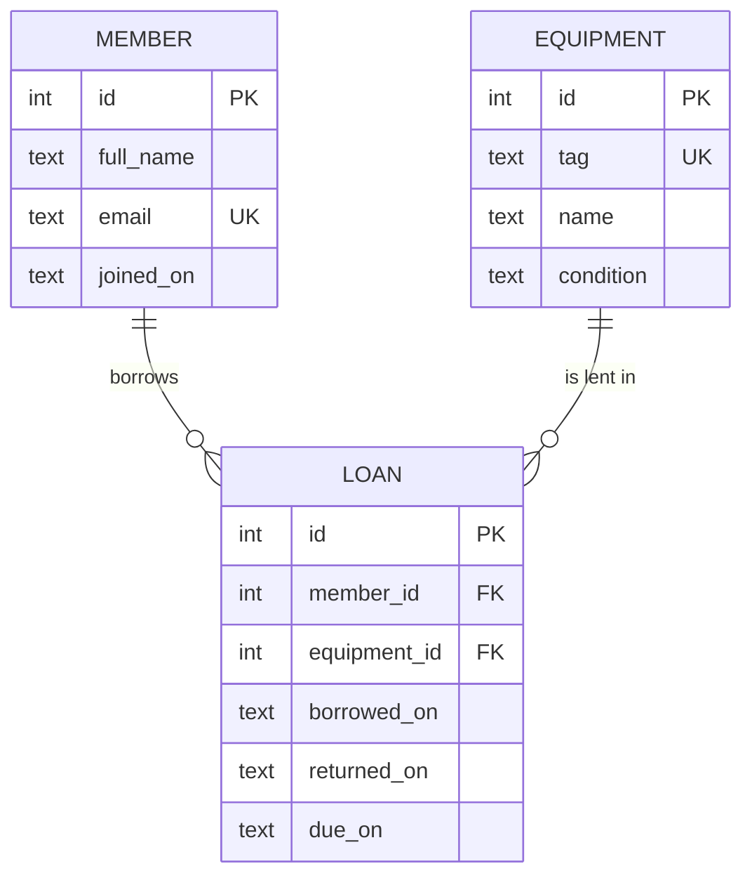

# Data model: Club equipment loans

## The app in one sentence

Committee members of a small outdoor club use it to record who has borrowed which piece of club equipment, and to see what is still out.

## Entities (the things the app stores)

| Entity | One row means... |
|---|---|
| member | one person in the club |
| equipment | one physical item the club owns, with a tag stuck on it |
| loan | one borrowing: one member took one item on one date |

## Fields

### member

| Field | Type | Required? | Rules (constraints) | Example |
|---|---|---|---|---|
| id | INTEGER | yes | PRIMARY KEY | 1 |
| full_name | TEXT | yes | NOT NULL | Aoife Byrne |
| email | TEXT | yes | NOT NULL, UNIQUE (one membership per email) | aoife@example.com |
| joined_on | TEXT | yes | NOT NULL, defaults to today | 2026-09-01 |

### equipment

| Field | Type | Required? | Rules (constraints) | Example |
|---|---|---|---|---|
| id | INTEGER | yes | PRIMARY KEY | 1 |
| tag | TEXT | yes | NOT NULL, UNIQUE (two items can never share a tag) | TENT-01 |
| name | TEXT | yes | NOT NULL | 4-person tent |
| condition | TEXT | yes | NOT NULL, default 'good', CHECK one of: good, worn, broken | good |

### loan

| Field | Type | Required? | Rules (constraints) | Example |
|---|---|---|---|---|
| id | INTEGER | yes | PRIMARY KEY | 1 |
| member_id | INTEGER | yes | NOT NULL, FOREIGN KEY to member(id), ON DELETE RESTRICT | 1 |
| equipment_id | INTEGER | yes | NOT NULL, FOREIGN KEY to equipment(id), ON DELETE RESTRICT | 1 |
| borrowed_on | TEXT | yes | NOT NULL, defaults to today | 2026-11-11 |
| returned_on | TEXT | no | empty means still out; CHECK returned_on is on or after borrowed_on | 2026-11-14 |
| due_on | TEXT | no | added in migration 002; CHECK due_on is on or after borrowed_on | 2026-11-25 |

Extra rule: **one item cannot be on two open loans at once** (a UNIQUE index on equipment_id that only applies while returned_on is empty).

## Relationships

- One member has many loans over time. Each loan belongs to exactly one member.
- One piece of equipment has many loans over time. Each loan is for exactly one piece of equipment.
- So loan is the "join" between member and equipment, and it carries the dates.

## The delete rule (my decision, with my reason)

If someone deletes a member or a piece of equipment that still has loans:

- [x] **RESTRICT**: block the delete.
- [ ] CASCADE: delete their loans too, silently.
- [ ] SET NULL: keep the loans but empty the link.

**I chose:** RESTRICT, for both member and equipment.

**Because:** the loan history is the club's record of who had what, and the committee needs it if an item comes back damaged or goes missing (our insurer asks). CASCADE would quietly wipe that record when someone leaves the club. SET NULL would keep a loan but forget who had the item, which is worse than useless. If a member leaves, we mark them as left (a future change) rather than deleting them.

## Diagram

## What I changed after testing

| Date | What I changed | Why (what testing showed me) |
|---|---|---|
| 2026-11-11 | Changed the generated `ON DELETE CASCADE` to `ON DELETE RESTRICT` on both foreign keys | The agent chose CASCADE without asking. It contradicts the delete rule above. |
| 2026-11-11 | Added `PRAGMA foreign_keys = ON` in `get_connection()` in db.py | My orphan-loan test insert (member 999) was accepted. SQLite ignores foreign keys unless every connection switches them on. |
| 2026-11-11 | Added the "one open loan per item" unique index | Testing showed the same tent could be lent to two people at once. |
| 2026-11-11 | Added `due_on` as a new migration, `schema/002_add_due_date.sql`, and filled in existing loans with borrowed_on + 14 days | The committee wants to see overdue items. Added as a new file because 001 was already applied to a database with real loans in it. |
