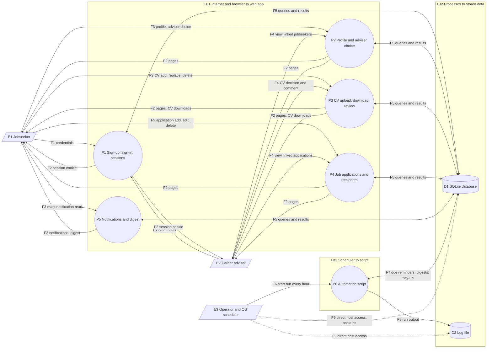

# Data flow diagram: Job Application Tracker

This diagram shows every external entity, process, data store and trust boundary, and numbers every data flow (F1 to F9). The threat analysis (`docs/threat-analysis.md`) uses the same numbers, so every flow here has a matching STRIDE section there.

It follows `docs/data-model.md`. Anything marked "(GUESS: please check)" is something I assumed and you have not confirmed.

## Diagram

TB4 (role and ownership boundary) is a logical boundary inside the app, so it is not drawn as a box. It is crossed by every flow marked TB4 in the table below.

## External entities

| ID | Name | What it is |
|---|---|---|
| E1 | Jobseeker | A person using a browser. Signs up, chooses an adviser, manages CVs and applications, reads notifications |
| E2 | Career adviser | A person using a browser. Signs up, sees their linked jobseekers, approves or rejects their CVs |
| E3 | Operator and OS scheduler | Whoever runs the computer and database, and the computer's own scheduler (cron or Task Scheduler) that starts the automation script. Not an application role: there is no administrator in the app |

No other external systems exist. The app sends no emails and calls no outside services. Employers are not users and are never contacted. If email or another outside service is added later, it becomes a new external entity and needs new flows.

## Processes

| ID | Process | What it does |
|---|---|---|
| P1 | Sign-up, sign-in, sessions | Creates accounts, checks passwords, starts and ends sessions |
| P2 | Profile and adviser choice | Edits the profile, lets a jobseeker choose an adviser once, shows an adviser their linked jobseekers |
| P3 | CV upload, download, review | Stores CVs, serves downloads to the owner and the linked adviser, records the adviser's decision, creates the decision notification |
| P4 | Job applications and reminders | Creates, edits and deletes applications. Creates and skips follow-up reminders when events happen |
| P5 | Notifications and digest | Lists notifications, marks them read, shows the weekly digest (figures worked out live) |
| P6 | Automation script | `tools/run_automations.py`. Every hour: processes due reminders, creates the Monday digest notification, tidies old records |

## Data stores

| ID | Store | What is in it |
|---|---|---|
| D1 | SQLite database (`app.db`) | user, cv (including the CV files), job_application, follow_up_reminder, notification |
| D2 | Log file (`automations.log`) | Text output of the automation script. It must hold counts only, never personal data |

## Trust boundaries

| ID | Boundary | Why it matters |
|---|---|---|
| TB1 | Internet and browser to web app | Everything from a browser is untrusted: forms, cookies, URLs, uploaded files |
| TB2 | Processes to stored data | Only the app's own OS account should reach the database and log file |
| TB3 | Scheduler to script | The script is started by the operating system, never by a web request |
| TB4 | Role and ownership (logical) | A jobseeker must not reach another jobseeker's data. An adviser must not reach data of jobseekers who are not linked to them |

## Data flows

| ID | From to | Data | Boundaries crossed |
|---|---|---|---|
| F1 | E1, E2 to P1 | Email, password, chosen role at sign-up | TB1 |
| F2 | P1 to P5 back to E1, E2 | Pages, session cookie, notifications, CV downloads, linked jobseekers' data | TB1, TB4 |
| F3 | E1 to P2, P3, P4, P5 | Profile edits, adviser choice, CV files, application details, mark-as-read | TB1 |
| F4 | E2 to P2, P3, P4 | Requests to view linked jobseekers and applications, CV decision and comment | TB1, TB4 |
| F5 | P1 to P5 and D1 | SQL queries and results, all personal data | TB2, TB4 |
| F6 | E3 to P6 | Start signal every hour | TB3 |
| F7 | P6 and D1 | Due reminders, new notifications, tidy-up deletes | TB2 |
| F8 | P6 to D2 | Run output text | TB2 |
| F9 | E3 to D1, D2 | Direct file access, backups, restores | TB2 |

## Notes

- CV files live inside D1. If you later move them to a folder on disk, add a new data store for that folder and new flows to it.
- The weekly digest figures are never stored. P5 works them out from D1 when the jobseeker opens the digest.
- Failed sign-in counting and a run history table are not in the data model yet, so they are not drawn. See the open points in `docs/threat-analysis.md`.
