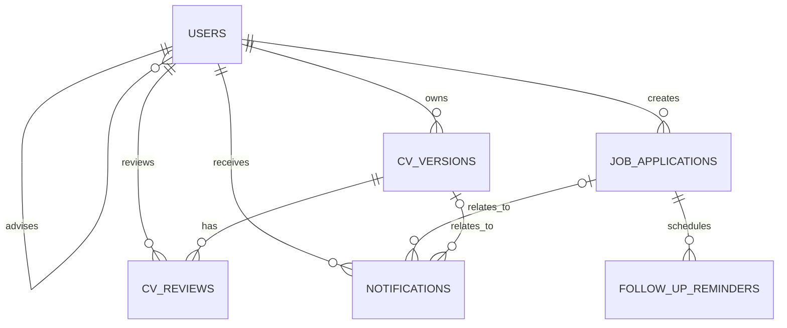

# Architecture and security evidence

**Application:** Pathway — Job Application Tracker PoC  
**Specification baseline:** v1.0, 20 November 2026

## 1. System summary

The application uses Python, Flask, Jinja templates, HTML/CSS and the standard-library `sqlite3` module. The two permitted roles are `jobseeker` and `career_adviser`. There is no administrator role or administrator console.

A jobseeker selects one registered adviser during onboarding. If no adviser exists, their account enters `awaiting_adviser` and has no adviser relationship until the jobseeker selects one. Assignment is permanent and enforced by route validation and a SQLite trigger. Advisers can read only the jobseekers assigned to them. Jobseekers can read and change only their own applications and CVs.

## 2. Entity relationship diagram

The editable Mermaid source is in `erd.mmd`.



### Tables and key constraints

| Table | Key relationships / rules |
|---|---|
| `users` | Unique email; role allow-list; self-reference `assigned_adviser_id`; adviser assignment and role immutability triggers |
| `cv_versions` | Owner FK; generated stored filename; approval state; `is_current`; partial unique index allows one current CV per jobseeker |
| `cv_reviews` | CV-version FK; adviser FK; decision allow-list; required comments and review timestamp |
| `job_applications` | Jobseeker FK; four-status allow-list; created/updated timestamps |
| `follow_up_reminders` | Application FK; due time; pending/sent/skipped state; processed timestamp |
| `notifications` | Recipient FK; optional application and CV references; unique optional deduplication key |
| `automation_runs` | Unique run key and result summary for scheduled task evidence |
| `login_attempts` | Hashed login identity and short-window failure count for basic login throttling |

SQLite foreign keys are enabled in the shared connection helper on every connection. SQL values use `?` placeholders. `schema.sql` defines the tables, indexes and triggers.

## 3. Level-1 data flow diagram

The editable Mermaid source is in `dfd-level-1.mmd`.

```mermaid
flowchart LR
    J[/(E1) Jobseeker/]
    A[/(E2) Career Adviser/]
    OP[/(E3) Server operator and OS scheduler/]
    subgraph TB1[TB1 Browser / HTTPS boundary]
      P1((P1 Authentication and accounts))
      P2((P2 Profiles and adviser assignment))
      P3((P3 CV management and approval))
      P4((P4 Job application management))
    end
    subgraph TB2[TB2 Application / data boundary]
      D1[(D1 SQLite database)]
      D2[(D2 Private CV storage)]
      P5((P5 Automation and notifications))
    end
    subgraph TB3[TB3 User-role / ownership boundary]
      R1[Jobseeker-owned records]
      R2[Assigned-adviser-only records]
    end
    subgraph TB4[TB4 Scheduled-process boundary]
      S1[Restricted OS scheduler identity]
    end
    J -->|Credentials and profile| P1
    A -->|Credentials and profile| P1
    P1 -->|Session result| J
    P1 -->|Session result| A
    J -->|Adviser choice and profile| P2
    A -->|Assigned jobseeker request| P2
    P2 <--> D1
    J -->|CV upload| P3
    A -->|Decision and comments| P3
    P3 <--> D1
    P3 <--> D2
    J -->|Application CRUD| P4
    A -->|Read assigned applications| P4
    P4 <--> D1
    P2 --> R1
    P2 --> R2
    OP -->|Scheduled invocation| S1
    S1 --> P5
    P5 <--> D1
    D1 -->|Digest / follow-up / CV result| J
```

### External entities

- **E1 Jobseeker:** registers, signs in, manages their profile, CV and applications, and receives notifications.
- **E2 Career Adviser:** registers, signs in, views assigned jobseekers and reviews their CVs.
- **E3 Server operator / host environment:** operates the Flask host, SQLite database, private files and OS scheduler. This is an infrastructure operator, not an application administrator role.

### Processes

- **P1:** authentication, registration, login, logout and session handling.
- **P2:** profiles, directory and permanent adviser assignment.
- **P3:** private CV upload, authorised download, adviser review and approval history.
- **P4:** job application create, read, update, delete and outcome management.
- **P5:** weekly digest and due follow-up processing, plus notification creation.

### Data stores and trust boundaries

- **D1:** SQLite users, assignment, CV metadata/reviews, application data, reminders and notifications.
- **D2:** uploaded CV document bytes in `instance/private_uploads/cv`, outside the static web directory.
- **TB1:** browser-to-application. Forms, cookies, URLs and uploads are untrusted; HTTPS is required in deployment.
- **TB2:** application-to-data. Only the application service account should access SQLite and private files.
- **TB3:** role/ownership. A jobseeker cannot read another jobseeker's data; adviser access is scoped to assigned jobseekers. Checks are performed in server routes and SQL.
- **TB4:** scheduled process. Run the automation script under the restricted application OS account; do not expose it as an unauthenticated web route.

## 4. Role-based CRUD permission matrix

**C** create · **R** read · **U** update · **D** delete · **—** no access

| Data / action | Jobseeker | Career Adviser |
|---|---|---|
| Own basic profile | C/R/U/D (account closure) | C/R/U/D (account closure) |
| Other users' profiles | — | R for assigned jobseekers only |
| Adviser directory | R | R |
| Adviser assignment | Select once during onboarding | R for assigned relationship; cannot reassign |
| Own CV versions | C/R/U (new version); deletion through account closure | — |
| Assigned jobseeker CV | — | R |
| CV review history | R for own CVs | C/R for assigned jobseekers; no edit/delete review action |
| Own job applications | C/R/U/D | — |
| Assigned jobseekers' applications | — | R only |
| Own notifications | R/U (mark read) | R/U (mark read) |
| Other users' notifications | — | — |

### Server-side enforcement examples

- Jobseeker applications always query by both application ID (where relevant) and `jobseeker_id = session user ID`.
- Adviser lists query `role = 'jobseeker' AND assigned_adviser_id = session adviser ID`.
- Adviser CV downloads and review writes join the CV owner and verify `assigned_adviser_id` on that request.
- Notifications are selected and updated with `user_id = session user ID`.
- No private CV URL is exposed through Flask static-file serving. Downloads use an authenticated route and generated storage name.
- Hiding a button is not used as authorisation.

SQLite does not provide built-in row-level security. The PoC enforces the data boundary in route-level checks and ownership-scoped SQL.

## 5. STRIDE threat analysis

| Flow / boundary | STRIDE | Threat | PoC mitigation / residual action |
|---|---|---|---|
| Browser → P1, TB1 | Spoofing | Attacker signs in as another user | Werkzeug password hashing, login-failure throttling, generic login errors, secure/HTTP-only session cookie options, session clear at logout; use HTTPS in deployment |
| Browser → P1, TB1 | Tampering | User submits a forged role | Server accepts only the two allow-listed roles; role is immutable after registration and protected by a database trigger |
| Browser → P2, TB1/TB3 | Elevation of privilege | Jobseeker changes adviser ID or accesses another profile | Adviser role validation, permanent-assignment trigger, role checks, ownership-scoped query predicates |
| Browser → P3, TB1 | Tampering | Malicious or oversized upload | 5 MB default limit, extension and MIME allow-list, PDF/OLE/OOXML signature validation, generated UUID storage name, private directory; malware scanning remains a production task |
| Browser → P3, TB1/TB3 | Information disclosure | Guessed CV URL exposes another user's document | No public file route; authenticated download verifies owner or assigned adviser on every request |
| Browser → P3, TB1 | Repudiation | Adviser disputes CV decision | Review row records adviser, decision, comments and timestamp; review history is not editable through the UI |
| Browser → P3, TB1 | Denial of service | Repeated uploads fill storage | Request size limit and bounded file size; production deployment should add request rate limits, quota monitoring and malware scanning |
| Browser → P4, TB1/TB3 | Spoofing | Forged request uses a stolen session | HTTP-only/SameSite cookie settings, CSRF tokens, HTTPS deployment, logout session clearing |
| Browser → P4, TB1 | Tampering | SQL injection or invalid statuses | Parameterised SQL, server-side field validation and database CHECK constraints |
| Browser → P4, TB1/TB3 | Information disclosure | Jobseeker changes record ID to read/edit another person's application | Every read/update/delete is scoped by both record ID and authenticated owner ID; advisers have read-only assigned queries |
| Browser → P4, TB1 | Repudiation | User disputes application updates | Created and updated timestamps are stored; a full status-change history is an identified enhancement before audit-grade use |
| Browser → P4, TB1 | Denial of service | Excessive requests or malformed URLs | Input length limits and URL validation; production proxy should apply request rate limits |
| P1/P2/P3/P4 → D1, TB2 | Tampering | Invalid references or SQL injection corrupt records | `sqlite3` parameter binding, FK enforcement, transactions, CHECK constraints, indexes and OS file permissions |
| P1/P2/P3/P4 → D1, TB2 | Information disclosure | Local user accesses database/backups | Restrict DB and backup filesystem permissions; encrypt host storage where appropriate; avoid collecting extra data |
| P3 → D2, TB2 | Tampering | Path traversal or file overwrite | Random generated storage names, extension/content validation, no original filename in filesystem path, fixed private upload directory |
| P3 → D2, TB2 | Information disclosure | Web server exposes private uploads as static content | Upload directory is outside `static`; download streams only after database authorisation |
| P5 → D1, TB4 | Spoofing | Unauthorised person runs scheduled script | Run under restricted application OS account; no unauthenticated web endpoint for automation |
| P5 → D1, TB4 | Tampering | Re-run or modification creates duplicate/false notices | Unique deduplication keys, reminder state checks and transactional updates; run outcome stored in `automation_runs` |
| P5 → D1, TB4 | Repudiation | No evidence that an automation ran | Automation task start/finish and result summary stored in `automation_runs` |
| P5 → D1, TB4 | Denial of service | Worker repeatedly processes due reminders | Process only pending due rows, mark processed, and make repeated runs idempotent; production use should add batch limits/monitoring |

### Additional baseline controls

CSRF protection is enabled for state-changing forms. Jinja autoescaping is used for template output. Security headers include `X-Content-Type-Options`, `X-Frame-Options`, `Referrer-Policy` and a restrictive Content Security Policy. Debug mode is disabled in the supplied run entry point. Deployment still requires HTTPS, a production WSGI server, secret management, dependency updates, secure backups, storage monitoring and an incident response process.

## 6. GDPR and data protection assessment (proposed baseline)

This is a design proposal, not legal advice or a finding of compliance. The organisation's data protection lead must confirm the lawful basis, controller/processor roles, retention periods and notices before real personal data is processed.

### Personal data in scope

- Account email and password hash.
- Jobseeker full name and phone number.
- Adviser assignment and adviser account name/email.
- CV document files and metadata (CV contents may contain additional personal information).
- Job application employer, job title, application date, advert URL and outcome.
- CV approval/rejection decision, adviser identity, comments and timestamp.
- In-app notification content and timestamps.

The application does not ask for date of birth, home address, demographic information or unrelated personal details.

### Proposed lawful basis

For a contracted career-support service, **performance of a contract (GDPR Article 6(1)(b))** may be appropriate where the processing is objectively necessary to provide the service requested and the organisation is a party to that service arrangement. If the organisation delivers a statutory or publicly funded service, it should assess **public task (Article 6(1)(e))** instead. The organisation must document the basis and purpose for each processing activity. Consent should not automatically be assumed to be the basis for all core service processing.

### Data minimisation and access

Only the specified account, contact, CV and application fields are collected. CV files are private and visible to the owner and assigned adviser. Advisers see only jobseekers assigned to them. Applications are editable only by their owner. Notifications are queried by recipient ID. Notifications and automation logs do not include CV document contents.

### Retention and deletion

The PoC provides account closure. Jobseeker closure deletes the profile and cascaded active CV metadata/reviews, applications, reminders and notifications, then removes CV files from private storage. Adviser closure is blocked while any jobseekers remain assigned because assignment is permanent and there is no admin role to reassign them. Adviser review records are removed when an unassigned adviser account is closed. Backup deletion is not immediate; the production operator must define and publish a backup expiry cycle and apply any narrowly justified legal retention exception with restricted access and a documented end date.

### Rights and transparency

The organisation must provide a full privacy notice covering controller identity, purposes, lawful basis, recipients, retention, transfers where relevant, rights and a contact route. It must establish operational procedures for access, rectification, erasure, restriction, objection where applicable and portability. The PoC account-closure function is not a complete data-subject-rights process.

### Production actions before live use

1. Confirm lawful basis and controller/processor arrangements with the organisation's data protection lead.
2. Approve a privacy notice and a retention schedule covering active records, CV version history, automation records and backups.
3. Resolve adviser account departure / permanent jobseeker assignment operations.
4. Review hosting, HTTPS, file storage, backups, filesystem permissions, malware scanning and incident response.
5. Add password reset, email verification and complete rights-request procedures if required by the service's risk assessment.

## 7. Automation design

| Pattern | Trigger / timing | Implementation | Duplicate / outcome control |
|---|---|---|---|
| Scheduled weekly digest | OS scheduler, Monday 09:00 server-local time by default | `run_automations.py` calls `run_weekly_digest` | Unique key per jobseeker and ISO week; current pipeline snapshot grouped by four statuses |
| Event-triggered follow-up | New `Applied` application; due 7 calendar days after creation | Application route creates `follow_up_reminders`; script processes due reminders | Status change cancels pending reminder; transition back to Applied creates a new seven-day reminder; processed status and notification dedupe key prevent repeats |
| Human CV approval | Jobseeker uploads a new version | Assigned adviser submits Approved/Rejected with required comments | `cv_reviews` retains decision, adviser, comments and timestamp; jobseeker receives a notification; new CV always starts Pending |

The weekly digest reports the current pipeline snapshot and labels the reporting week as the week commencing Monday. Reminder timing is stored and compared in UTC ISO-8601 timestamps. The OS scheduler uses server-local time for its invocation.

## 8. Known PoC limits and assumptions

- No email verification, password reset, SMS, email or push notifications.
- No task queue or in-process Flask background thread; the OS scheduler invokes the standalone script.
- Current application status and update timestamp are stored; an application status-history table is a recommended enhancement for audit-grade needs.
- The follow-up notification asks the jobseeker to consider contacting the employer; the system does not contact employers.
- Malware scanning, edge rate limiting, backup expiry automation and a full data-subject-rights workflow require deployment/organisation-level implementation.
- Before real-data use, the organisation must resolve adviser account closure and validate its legal basis, retention and safeguards.
