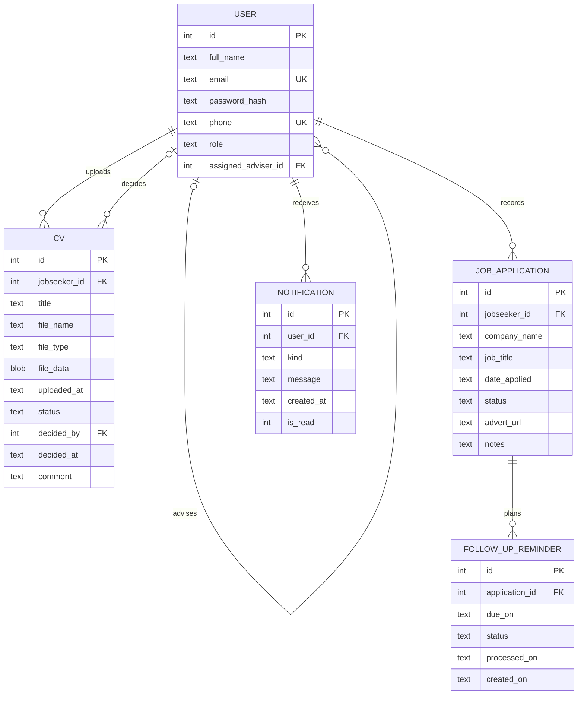

# Data model: Job Application Tracker

Draft from the interview, updated on 2026-11-23 to match the existing app on three points: each jobseeker has a linked adviser, the follow-up nudge is event-driven, and role rules are enforced by the database itself. Anything marked "(GUESS: please check)" is something I assumed and you have not confirmed.

## The app in one sentence

Jobseekers use it to track the jobs they have applied for and to upload their CVs. Each jobseeker chooses one career adviser, who approves or rejects that jobseeker's CVs and can see that jobseeker's applications (read-only).

## Entities (the things the app stores)

| Entity | One row means... |
|---|---|
| user | one person with an account. Jobseekers and career advisers share this one list, and a role label tells them apart |
| cv | one CV file uploaded by one jobseeker, plus the decision of that jobseeker's adviser on it |
| job_application | one job that one jobseeker has applied for |
| follow_up_reminder | one planned follow-up nudge for one application (waiting, sent or skipped) |
| notification | one short in-app message for one jobseeker (follow-up nudge, weekly digest, or CV decision) |

## Fields

### user

| Field | Type | Required? | Rules (constraints) | Example |
|---|---|---|---|---|
| id | INTEGER | yes | PRIMARY KEY | 1 |
| full_name | TEXT | yes | NOT NULL, must not be blank | Anna Murphy |
| email | TEXT | yes | NOT NULL, UNIQUE across all users (jobseekers and advisers together), capital letters ignored, so Anna@x.com and anna@x.com are the same email | anna@example.com |
| password_hash | TEXT | yes | NOT NULL. Only the scrambled password is ever stored, never the real one. No length limit decided yet | (long scrambled text) |
| phone | TEXT | no | UNIQUE across all users when given. Blank is stored as empty (NULL), never as empty text, so many people can leave it blank | 087 123 4567 |
| role | TEXT | yes | NOT NULL, CHECK: only `jobseeker` or `adviser`. One role per person | jobseeker |
| assigned_adviser_id | INTEGER | no | FOREIGN KEY to user(id), allows NULL. A jobseeker's chosen adviser. Always empty for advisers. Empty for a jobseeker means "awaiting adviser" | 7 |

Database rules on user (the database refuses anything that breaks them):

- The role can never be changed after the account is created.
- Only a jobseeker can have an assigned adviser, and the person assigned must have the role `adviser`.
- The jobseeker chooses the adviser once. After that it can never be switched to a different adviser. (GUESS: please check "once only", it matches the existing app.) The link only becomes empty if the adviser's account is deleted (Delete rule 2). The jobseeker is then "awaiting adviser" and can choose a new adviser, once, again.

Password rules (checked by the app, not the database, because the database only sees the scrambled version):

- at least 8 characters
- at least 1 capital letter
- at least 1 special character, meaning any character that is not A-Z, a-z or 0-9. Accented letters (like é) are allowed but do not count as special
- no spaces

### cv

| Field | Type | Required? | Rules (constraints) | Example |
|---|---|---|---|---|
| id | INTEGER | yes | PRIMARY KEY | 1 |
| jobseeker_id | INTEGER | yes | NOT NULL, FOREIGN KEY to user(id). Must be a user with role `jobseeker` | 3 |
| title | TEXT | yes | NOT NULL, must not be blank | Marketing CV, May |
| file_name | TEXT | yes | NOT NULL | anna_cv.pdf |
| file_type | TEXT | yes | NOT NULL, CHECK: only `pdf`, `doc` or `docx` | pdf |
| file_data | BLOB | yes | NOT NULL, CHECK: not empty and at most 1,048,576 bytes (1 MB). Exactly 1,048,576 is accepted, anything larger is refused. The file is stored inside the database | (file contents) |
| uploaded_at | TEXT | yes | NOT NULL, filled in automatically when the CV is added. Form `YYYY-MM-DD` | 2026-11-22 |
| status | TEXT | yes | NOT NULL, CHECK: only `waiting_for_review`, `approved` or `rejected`. A new CV always starts as `waiting_for_review` | waiting_for_review |
| decided_by | INTEGER | no | FOREIGN KEY to user(id), must allow NULL. Empty until a decision is made. Must be the adviser assigned to the CV's owner | 7 |
| decided_at | TEXT | no | Empty until a decision is made. Form `YYYY-MM-DD` | 2026-11-23 |
| comment | TEXT | no | Only allowed when status is `rejected`. Empty otherwise | Please add your last job |

Rules that tie these fields together (CHECK):

- `waiting_for_review`: decided_by, decided_at and comment must all be empty.
- `approved`: decided_at must be filled and comment must be empty.
- `rejected`: decided_at must be filled and comment is optional.
- decided_by cannot be required for a decided CV, because it can become empty if the adviser's link is removed (see Delete rule 3).

Database rules on cv:

- The owner must be a jobseeker, never an adviser.
- A decision can only be recorded by the adviser assigned to the CV's owner. An adviser can never decide the CV of a jobseeker who is not linked to them, and a jobseeker with no adviser cannot have a CV decided.

A jobseeker can edit or delete their own CV at any time, including after it has been decided. Deleting a CV simply removes it. Editing only the title leaves the decision alone. Replacing the file puts the CV back to `waiting_for_review`, empties decided_by, decided_at and comment, and counts as a new upload (uploaded_at changes), because the adviser signed off a different file.

No link to job applications. CVs and applications are two separate lists belonging to the same jobseeker.

### job_application

| Field | Type | Required? | Rules (constraints) | Example |
|---|---|---|---|---|
| id | INTEGER | yes | PRIMARY KEY | 1 |
| jobseeker_id | INTEGER | yes | NOT NULL, FOREIGN KEY to user(id). Must be a user with role `jobseeker` | 3 |
| company_name | TEXT | yes | NOT NULL, must not be blank. No length limit decided yet | Acme Ltd |
| job_title | TEXT | yes | NOT NULL, must not be blank. No length limit decided yet | Data Analyst |
| date_applied | TEXT | yes | NOT NULL, form `YYYY-MM-DD`, a real calendar date. A future date is not allowed (checked by the app, see "Rules the database cannot check by itself") | 2026-11-15 |
| status | TEXT | yes | NOT NULL, CHECK: only `applied`, `interview`, `rejected` or `withdrawn`. A new application always starts as `applied` and can never move back to it once it has left it (see "Rules the database cannot check by itself"). There is no "offer" stage | applied |
| advert_url | TEXT | no | CHECK: must start with `http://` or `https://` and contain no spaces. The database checks the written form only, not that the website exists | https://acme.example/jobs/42 |
| notes | TEXT | no | The jobseeker's own notes. The linked adviser can read them (read only), so the form should say so | Phone screen went well |

Employer contact details are not stored. "Contact details" in the project rules means the jobseeker's own phone and email, which already live on the user row.

Database rule on job_application: the owner must be a jobseeker, never an adviser.

### follow_up_reminder

New table. It replaces the old "last reminder sent" field on job_application.

| Field | Type | Required? | Rules (constraints) | Example |
|---|---|---|---|---|
| id | INTEGER | yes | PRIMARY KEY | 1 |
| application_id | INTEGER | yes | NOT NULL, FOREIGN KEY to job_application(id) | 1 |
| due_on | TEXT | yes | NOT NULL, form `YYYY-MM-DD`. The first reminder is due 7 days after date_applied | 2026-11-22 |
| status | TEXT | yes | NOT NULL, DEFAULT `pending`, CHECK: only `pending`, `sent` or `skipped` | pending |
| processed_on | TEXT | no | Form `YYYY-MM-DD`. CHECK: empty while `pending`, filled once `sent` or `skipped` | 2026-11-22 |
| created_on | TEXT | yes | NOT NULL, filled in automatically. Form `YYYY-MM-DD` | 2026-11-15 |

Database rule: an application can have at most one `pending` reminder at a time, so a double run can never create two waiting nudges for the same application.

### notification

| Field | Type | Required? | Rules (constraints) | Example |
|---|---|---|---|---|
| id | INTEGER | yes | PRIMARY KEY | 1 |
| user_id | INTEGER | yes | NOT NULL, FOREIGN KEY to user(id). The owner, who must be a user with role `jobseeker` | 3 |
| kind | TEXT | yes | NOT NULL, CHECK: only `nudge`, `digest` or `cv_decision` (GUESS: please check the new `cv_decision`) | nudge |
| message | TEXT | yes | NOT NULL, must not be blank | No reply yet from Acme Ltd (Data Analyst). Time to follow up? |
| created_at | TEXT | yes | NOT NULL, form `YYYY-MM-DD` (date only, no time) | 2026-11-22 |
| is_read | INTEGER | yes | NOT NULL, DEFAULT 0, CHECK: only 0 (unread) or 1 (read). SQLite has no true/false type | 0 |

Tip: SQLite has no date type. Store dates as TEXT in the form `YYYY-MM-DD` so they sort and compare correctly.

## Relationships

- One adviser has many jobseekers. Each jobseeker has at most one adviser, chosen by the jobseeker. Advisers have none.
- One jobseeker has many CVs. Each CV belongs to exactly one jobseeker, the one who uploaded it.
- One adviser can decide many CVs, but only CVs of their own linked jobseekers. Each CV is decided by at most one adviser.
- One jobseeker has many job applications. Each application belongs to exactly one jobseeker.
- One job application has many follow-up reminders over time, but only one waiting at a time.
- One jobseeker has many notifications. Each notification belongs to exactly one jobseeker.
- The same email, and the same phone number, can never belong to two different users, whatever their roles.

## Who can see and change what (role-based access)

| Data | Jobseeker | Linked adviser | Any other adviser |
|---|---|---|---|
| Own account | read, edit, close | read, edit, close (own) | read, edit, close (own) |
| A jobseeker's name and email | own | read | none |
| A jobseeker's phone number | own | none | none |
| Adviser list (names) | read, to choose one | read | read |
| The adviser link | choose once | read | none |
| CVs | add, replace, edit title, delete, read (own) | read, approve or reject (only linked jobseekers') | none |
| Job applications, including notes | add, read, edit, delete (own) | read only, notes included | none |
| Follow-up reminders | none directly, the system manages them | none | none |
| Notifications | read, mark as read (own) | none (advisers get none) | none |

How it is enforced, in two layers:

1. **The database refuses impossible or forbidden combinations.** The role can never change. Only a jobseeker can own CVs, applications and notifications. Only an adviser can be linked to a jobseeker. A CV decision can only come from the adviser linked to the CV's owner. This holds even if the app has a bug, because the data itself rejects it.
2. **Every query in the app is limited by who is signed in.** Jobseekers only ever load rows where the owner is their own id. Advisers only load jobseekers whose assigned adviser is their own id. A record that is not yours gives a 404 page. Hiding a button is never used as the protection. Tests try each forbidden action as the wrong role.

SQLite has no per-user permissions (nothing like GRANT), so the database cannot know who is signed in. That is why layer 2 is needed in addition to layer 1. Not used, but possible: a separate read-only database connection for advisers on application data.

## The delete rules (my decisions, with my reasons)

Reason in my own words: data privacy. No data should remain in the database after a user (jobseeker or career adviser) deletes their own account, because the data stored belongs to that user.

### Rule 1: deleting a jobseeker who still has CVs, applications, reminders and notifications

- [ ] **RESTRICT**: block the delete.
- [x] **CASCADE**: delete the CVs, applications, reminders and notifications too, silently.
- [ ] **SET NULL**: keep them with an empty link.

**I chose:** CASCADE.

**Because:** the data belongs to the jobseeker, so deleting their account must remove all of it. Side effect to be aware of: the adviser's decisions and comments on those CVs are deleted along with the CVs. Reminders go when their application goes, and notifications go with the jobseeker. (GUESS: please check that reminders follow the same rule, it matches the existing app.)

### Rule 2: deleting an adviser who still has jobseekers linked to them

Decided on 2026-11-23.

- [ ] **RESTRICT**: block the delete until every linked jobseeker has closed their account. (The existing app does this, because it has no administrator to reassign jobseekers.)
- [x] **SET NULL**: the adviser goes, and their jobseekers become "awaiting adviser" and can choose a new one.
- [ ] **CASCADE**: not sensible, it would delete the jobseekers' accounts.

**I chose:** SET NULL on `assigned_adviser_id`. The jobseeker's account, CVs, applications and notifications stay exactly as they are. The jobseeker becomes "awaiting adviser" and can choose a new adviser. CVs the old adviser had decided keep their status, date and comment, with "decided by" blank (Rule 3).

**Because:** an adviser who deletes their own profile cannot affect a jobseeker's profile. Jobseekers are the only owners of their profile and data, so it has to stay even after a linked adviser leaves.

### Rule 3: deleting an adviser who has already decided CVs

- [ ] **RESTRICT**: block the delete.
- [ ] **CASCADE**: delete the CVs they decided.
- [x] **SET NULL**: keep the CVs and empty the "decided by" link.

**I chose:** SET NULL on `decided_by`. The CV stays with its status (approved or rejected), its decision date and its comment. Only "decided by" becomes blank.

**Because:** the CVs belong to the jobseekers, so jobseekers' data stays untouched when an adviser leaves, while the adviser's identity is removed. The comment stays because it is part of the jobseeker's CV record. (GUESS: please check this wording, I wrote it from your answer.)

Note: because Rule 2 is SET NULL, this rule is live. When an adviser leaves, their jobseekers are unlinked, and the CVs the adviser decided keep their outcome, date and comment. A CV that is still waiting for review stays waiting until the jobseeker chooses a new adviser, and an approved CV stays approved. (GUESS: please check)

Both rules only work if every connection to the database runs `PRAGMA foreign_keys = ON` (see AGENTS.md).

## Rules the database cannot check by itself

1. **Password rules** (length, capital, special character, no spaces). The app checks them before the password is scrambled.
2. **Who is signed in.** The database cannot know it. The app limits every query by the signed-in user (see "Who can see and change what").
3. **That a CV file really is a Word or PDF file.** The database only stores the file type label and the size limit. The app checks the actual file.
4. **That an advert link opens a real page.** The database checks the written form only. The app can check the form more strictly.
5. **Email and phone format.** No format rule was given, so only "required" and "never repeated" are enforced. Two phone numbers written differently (087... and +353 87...) would count as different.
6. **No future date applied.** The app checks it using the Irish date. The database clock is UTC, so just after midnight in summer a correct date could look like tomorrow. The database still checks that the date is written as a real `YYYY-MM-DD` date. No database trigger is used for this.
7. **An application can never move back to `applied`.** A plain database rule cannot compare the old and new value of a field, so the app refuses that move. No database trigger is used for this. Other moves between `interview`, `rejected` and `withdrawn` are not restricted.
8. **Creating and skipping reminders.** The app does it at the moment of the event, in the same step as the change that caused it (see "Automations"). (GUESS: please check, a database trigger could do it instead.)
9. **Hiding one field from advisers.** The database cannot hide a single column such as the phone number from one role. The app's adviser queries must never select the jobseeker's phone number, and a test checks it.

## Automations

**Scheduled: weekly pipeline digest.** Every Monday at 8:00 Irish time, for jobseekers only. A jobseeker with no applications gets none. It shows how many applications are at each stage and which are still at `applied`. The figures are worked out live when the jobseeker opens it, so they are never stored. The task creates one short notification ("Your weekly digest is ready", kind `digest`) and first checks that no `digest` notification already exists for that jobseeker today, so running twice never creates it twice.

**Event-triggered: follow-up nudge.** The nudge starts from events, not from a time check:

- *Event: an application is saved.* The app creates a `pending` reminder due 7 days after date_applied, in the same step as saving the application.
- *Event: an application leaves `applied`* (to interview, rejected or withdrawn). The app marks its `pending` reminder `skipped`. Because an application can never move back to `applied`, this is final.
- *Event: a reminder is sent.* The app creates the next `pending` reminder, due 7 days later, as long as the application is still `applied`. So the nudge repeats every 7 days until the stage changes. (GUESS: please check, the existing app sends only one nudge.)
- *Processing.* Every hour the script looks for `pending` reminders that are due (using the Irish date). If the application is still `applied`, it creates a `nudge` notification for the jobseeker and marks the reminder `sent`. If not, it marks the reminder `skipped`. A reminder that is already `sent` or `skipped` is never processed again.

The employer is never contacted. Nothing is stored about whether an employer replied: the stage tells it.

**Event-triggered: CV decision notification.** When an adviser approves or rejects a CV, the app creates a `cv_decision` notification for the jobseeker in the same step. The message names the CV and the outcome. It does not copy the comment, so the comment stays only on the CV. (GUESS: please check)

**Human approval step: CV sign-off.** A jobseeker's CV waits for review until the linked adviser approves or rejects it.

**Scheduled: tidy-up.** The same hourly script deletes read notifications and finished (`sent` or `skipped`) reminders once they are older than the periods in `docs/data-protection.md`. (GUESS: please check the periods and the idea)

All of this is done by one script, `tools/run_automations.py`, started every hour, on the hour, by the computer's own scheduler (cron on Mac and Linux, Task Scheduler on Windows). No scheduler library is added. The script works out Irish time itself. It reads and writes the same database through `get_connection()`.

## Diagram

## Known differences between this document and the code

The app has been moved onto this data model (2026-11-24). What the code still does not have:

- **No limit on failed sign-ins.** The earlier version of the app counted failed attempts in a `login_attempts` table. That table is not in this data model, so the limit is gone. It is open point B in `docs/threat-analysis.md`.
- **No run history.** The earlier `automation_runs` table is not in this data model either (open point D). The hourly script prints counts only, for a log file.
- **A bookkeeping table.** `tools/migrate.py` creates a small table called `schema_migration` to remember which files in `schema/` it has applied. It is not part of this data model.
- **The tidy-up job** uses the retention periods in `docs/data-protection.md`, which are proposals (GUESS: please check).
- **Time zone support.** The code uses Python's `zoneinfo` for Irish time. On Windows this needs the `tzdata` package, otherwise the code falls back to UTC.

## What I changed after testing

Fill this in as you go. It is great material for the "design decisions" section of your CA2 write-up.

| Date | What I changed | Why (what testing showed me) |
|---|---|---|
| 2026-11-23 | Removed AUTOINCREMENT after INTEGER PRIMARY KEY on 001_initial.sql | With AUTOINCREMENT SQLite remembers the highest number it has ever handed out, so an id is never used twice, even after its row is deleted. Without it SQLite gives each new row the highest id that currently exists, plus 1. If the newest row has been deleted, its number can be used again. |
| 2026-11-23 | Deleted an ORPHAN ROW from SQLite database | ORPHAN ROWS (rows that point at something that does not exist): "DELETE FROM follow_up_reminder WHERE application_id = 999" |
| 2026-11-24 | Moved the whole app onto this schema (CVs now stored inside the database, one table per entity in this file) | The earlier app used a different schema. The ported app passes 114 tests against this one |
